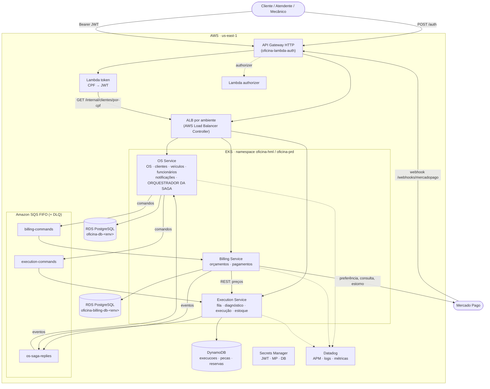
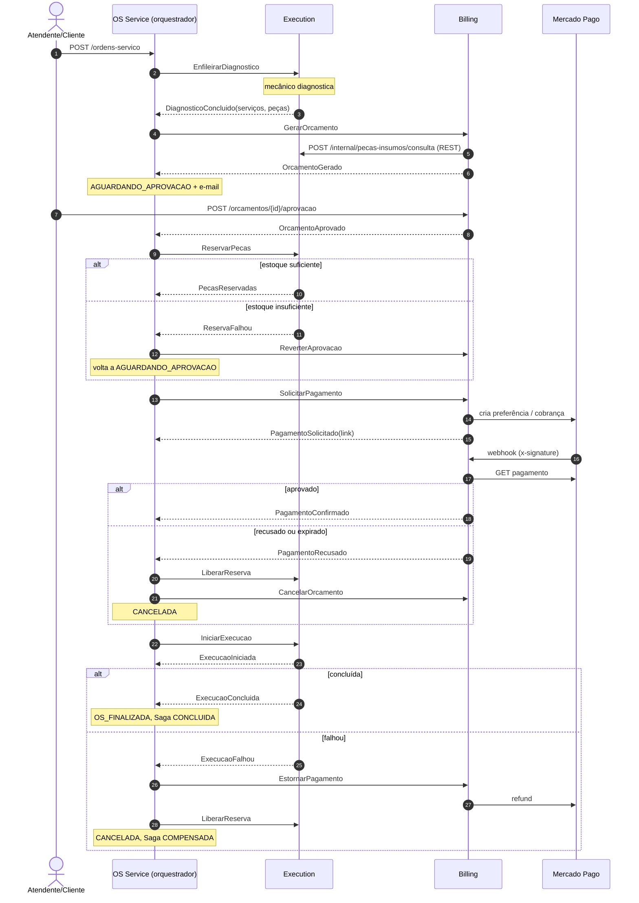
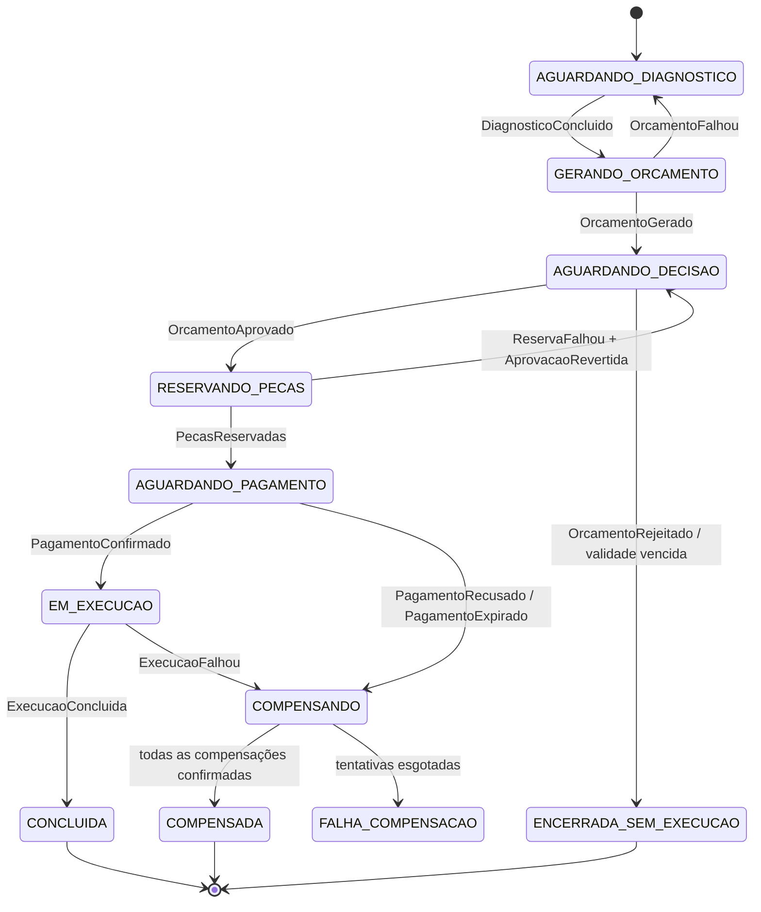
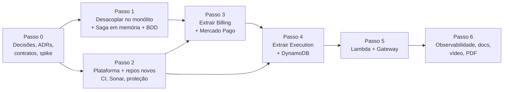

# Plano Fase 4 — Microsserviços, Saga e Mercado Pago

> **Projeto:** Tech Challenge SOAT 13 — Oficina Mecânica
> **Data da análise:** 14/10/2026
> **Base:** os 4 repositórios locais (`oficina-app`, `oficina-infra-k8s`, `oficina-infra-database`, `oficina-lambda-auth`) e os enunciados da Fase 3 e da Fase 4.
> **Status:** decisões da seção 15 confirmadas em 15/10/2026 (todas conforme a recomendação). Passos 0, 1 e 3 integrados em `desenvolvimento`; Passo 4 com E1, E2 e as entregas 10 e 11 prontas em branches locais, aguardando PR — ver [seção 18](#18-andamento).
>
> **Vai continuar o desenvolvimento? Comece pela [seção 18.5](#185-como-continuar)** (estado atual, regras do grupo, ambiente local, roteiro do Passo 4 e do dia do deploy).
>
> Este arquivo mora em `oficina-app/docs/PLANO-FASE-4.md` desde 16/10/2026. Atualize a seção 18 a cada entrega.

Itens marcados com **(verificar)** vêm de conhecimento prévio e não foram conferidos em documentação oficial durante a análise. Valores de custo são **aproximados**.

---

## Sumário

1. [Resumo executivo](#1-resumo-executivo)
2. [Requisitos da Fase 4 × estado atual](#2-requisitos-da-fase-4--estado-atual)
3. [Estado atual dos repositórios](#3-estado-atual-dos-repositórios)
4. [Arquitetura alvo](#4-arquitetura-alvo)
5. [Comunicação entre serviços](#5-comunicação-entre-serviços)
6. [Saga orquestrada](#6-saga-orquestrada)
7. [Integração com Mercado Pago](#7-integração-com-mercado-pago)
8. [Mudanças por repositório](#8-mudanças-por-repositório)
9. [Infraestrutura, capacidade e custos](#9-infraestrutura-capacidade-e-custos)
10. [Testes e qualidade](#10-testes-e-qualidade)
11. [CI/CD e proteção dos repositórios](#11-cicd-e-proteção-dos-repositórios)
12. [Observabilidade](#12-observabilidade)
13. [Ordem de execução e por onde começar](#13-ordem-de-execução-e-por-onde-começar)
14. [Entregáveis](#14-entregáveis)
15. [Decisões em aberto](#15-decisões-em-aberto)
16. [Riscos e mitigação](#16-riscos-e-mitigação)
17. [Arquivos analisados](#17-arquivos-analisados)
18. [Andamento](#18-andamento)

---

## 1. Resumo executivo

**Decisão proposta:** o monólito `oficina-app` vira o **OS Service** (dono da ordem de serviço, dos cadastros e do **orquestrador da Saga**). Nascem dois repositórios novos:

| Serviço | Repositório | Responsabilidade | Banco |
|---|---|---|---|
| **OS Service** | `oficina-app` (renomear para `oficina-os-service` é opcional) | Abertura da OS, status, histórico, clientes, veículos, funcionários, notificações, login de funcionários, **orquestrador da Saga** | PostgreSQL (RDS atual) |
| **Billing Service** | `oficina-billing-service` (novo) | Orçamentos, aprovação/rejeição, **pagamento via Mercado Pago**, estorno | PostgreSQL (RDS novo) |
| **Execution Service** | `oficina-execution-service` (novo) | Fila de execução, diagnóstico, reparo, **estoque de peças** e reservas | **DynamoDB** (NoSQL) |

Comunicação: **REST síncrono** só onde a resposta é necessária na hora (preços de peças, cliente por CPF) e **Amazon SQS FIFO** para comandos e eventos da Saga, com **outbox transacional** e **idempotência** nos consumidores.

**O que já existe e será reaproveitado:**

- Arquitetura hexagonal por módulo (`domain / application / infrastructure`) — extrair um módulo vira mover o pacote e trocar adapters.
- Padrão de **outbox com reprocessamento** do módulo `notificacao` — base para o outbox de mensagens.
- **JaCoCo com gate de 80%**, Testcontainers, Swagger, collection Insomnia.
- Pipeline padronizado (`testes → testes-integracao → validacao → build → deploy`), `pr-source-guard.yml`, Kustomize base + overlays `hml`/`prd`.
- Datadog completo (agent, APM, logs JSON ECS, dashboard, 8 monitores, synthetic, SLO).
- Padrão de Terraform com `terraform_remote_state` e workspaces `hml`/`prd` (usado em `oficina-infra-database` e `oficina-lambda-auth`).
- AWS SDK v2 já está no `pom.xml` (por causa do SES) — SQS e DynamoDB entram sem framework novo.

**O que falta construir:** os 2 serviços novos, mensageria, Saga com compensações, Mercado Pago, banco NoSQL, BDD, Sonar no CI, histórico de status da OS e a correção da Lambda, que hoje lê a tabela `clientes` diretamente.

**Por onde começar:** Passo 0 (ADRs + contratos das mensagens) e Passo 1 (desacoplar os módulos **dentro do monólito**, na branch `feature/fase4-desacoplamento` do `oficina-app`) — detalhes na [seção 13](#13-ordem-de-execução-e-por-onde-começar).

---

## 2. Requisitos da Fase 4 × estado atual

| # | Requisito (enunciado Fase 4) | Estado hoje | O que fazer |
|---|---|---|---|
| 1 | No mínimo 3 microsserviços independentes | **Falta** — monólito com 7 módulos | Extrair Billing e Execution; `oficina-app` vira OS Service |
| 2 | Repositório próprio por microsserviço | **Falta** — 1 repositório de aplicação | Criar `oficina-billing-service` e `oficina-execution-service` |
| 3 | Infraestrutura própria por microsserviço | **Parcial** — infra central em `oficina-infra-k8s` e `oficina-infra-database` | Pasta `infra/` (Terraform) em cada serviço: ECR, banco, filas, IAM |
| 4 | Banco de dados próprio por microsserviço | **Falta** — 1 RDS PostgreSQL por ambiente, compartilhado | OS mantém o RDS atual; Billing ganha RDS; Execution usa DynamoDB |
| 5 | Pelo menos 1 banco SQL e 1 NoSQL | **Falta** — só PostgreSQL | DynamoDB na Execution |
| 6 | APIs REST síncronas quando necessário | **Parcial** — só REST externo | REST interno: Billing → Execution (preços); Lambda → OS (cliente por CPF) |
| 7 | Mensageria assíncrona (RabbitMQ, Kafka, SQS…) | **Falta** — só eventos Spring em memória | SQS FIFO + DLQ |
| 8 | **Nenhum serviço acessa o banco de outro** | **Viola** — Lambda faz `SELECT … FROM clientes` (`src/lib/banco.mjs`); módulos usam repositórios uns dos outros | Endpoint interno no OS Service + comandos/eventos |
| 9 | Saga Pattern com rollback/compensação | **Falta** — só existe desfazer reservas dentro de `AprovarOrcamentoService` | Orquestrador no OS Service, compensação em cada passo |
| 10 | Documentar e justificar a Saga no README | **Falta** | ADR + seção no README de cada serviço |
| 11 | Pagamentos integrados ao Mercado Pago | **Falta** — não há nada de pagamento | Billing: Checkout Pro (ou API de pagamentos), webhook, estorno |
| 12 | Testes unitários em todos os serviços | **OK no app** (104 arquivos de teste) | Replicar nos serviços novos |
| 13 | Pelo menos 1 fluxo completo com BDD | **Falta** — sem Cucumber | Cucumber no OS Service cobrindo a Saga |
| 14 | Cobertura mínima de 80% por serviço | **OK no app** — JaCoCo `minimum 0.80` por pacote | Gate de 80% desde o primeiro commit nos serviços novos |
| 15 | SonarQube (ou similar) no CI | **Falta** — Sonar só roda manualmente (README); `ci-cd.yml` não chama | Job `qualidade` com quality gate obrigatório |
| 16 | Pipeline independente: build, testes, qualidade, deploy em Kubernetes | **Parcial** — falta o passo de qualidade | Acrescentar `qualidade`; copiar o pipeline nos serviços novos |
| 17 | Repositórios protegidos (PR obrigatório + checagens) | **OK** — `pr-source-guard.yml` e regras de branch | Replicar + status checks obrigatórios (testes, qualidade, guard) |
| 18 | Mensageria para orquestração ou coreografia | **Falta** | SQS |
| 19 | Monitoramento da Fase 3 | **Parcial** — tudo amarrado ao serviço `oficina-api` (14 referências em `oficina-infra-k8s`) | Parametrizar por serviço; trace atravessando o SQS; widgets da Saga |
| 20 | Swagger ou Postman atualizados | **Parcial** — Swagger e Insomnia do monólito | Swagger por serviço + collection do fluxo completo |
| 21 | OS Service: "consulta de status e **histórico**" | **Parcial** — só existe `situacao_alterada_em` | Tabela `ordem_servico_historico` + endpoint de histórico |
| 22 | Usuário `soat-architecture` nos repositórios (exigido na Fase 3) | OK nos 4 atuais | Adicionar nos 2 novos |

---

## 3. Estado atual dos repositórios

### 3.1 `oficina-app` — aplicação

- **Stack:** Java 21, Spring Boot 4.0.5 (WebMVC, Security, Validation, Actuator, Mail), Spring Data JPA, Flyway (**20 migrations**, V1 a V20), PostgreSQL 15, `jjwt` 0.12.6, `caelum-stella`, `springdoc-openapi`, AWS SDK v2 (SES), Micrometer Prometheus, `dd-java-agent`.
- **Módulos** (`src/main/java/br/com/oficina/`): `auth`, `cliente`, `veiculo`, `ordemservico` (inclui funcionários), `orcamento`, `pecainsumo`, `notificacao`, `common`, `config`.
- **Testes:** 104 arquivos, JUnit 5, Mockito, H2, Testcontainers (`postgres:16-alpine`), JaCoCo com `minimum 0.80` em linhas e branches por pacote.
- **Kubernetes:** Kustomize `k8s/base` (ServiceAccount, Deployment, Service `LoadBalancer` → NLB público, HPA CPU 70%/memória 80%) + overlays `hml` e `prd` (namespace, ResourceQuota, `app.env`, patches).
- **CI/CD** (`.github/workflows/ci-cd.yml`): `testes` → `testes-integracao` → `validacao` (kustomize) → `build` (ECR, tag `<ambiente>-<sha>`) → `deploy` (descobre RDS e role SES, cria Secrets, aplica overlay, espera rollout, healthcheck pelo NLB). Push em `homologacao` → `oficina-hml`; push em `master` → `oficina-prd`. Mais `pr-source-guard.yml` (fluxo `feature/*` → `desenvolvimento` → `homologacao` → `master`).
- **Fluxo da OS hoje** (`StatusOrdemDeServico`): `OS_ABERTA → DIAGNOSTICO_EM_ANDAMENTO → DIAGNOSTICO_CONCLUIDO → ORCAMENTO_GERADO / AGUARDANDO_APROVACAO → SERVICO_EM_ANDAMENTO → OS_FINALIZADA → ENTREGUE`. Situações externas: Recebida, Diagnóstico, Aguardando Aprovação, Execução, Finalizada, Entregue. `MotivoEncerramento`: `SERVICO_CONCLUIDO`, `ORCAMENTO_RECUSADO`.
- **Orçamento:** `StatusOrcamento` = `AGUARDANDO_APROVACAO`, `APROVADO`, `REJEITADO`; tem `validade`. Decisão pode vir por JWT (`/orcamentos/{id}/aprovacao`) ou por webhook (`/integracoes/orcamentos/{numero}/decisao` com `X-Webhook-Token`).
- **Notificação:** outbox em tabela `notificacoes`, envio `@Async` a cada mudança de situação, reprocessamento agendado, SES em nuvem (profile `ses`) e Mailhog local.
- **Custo atual documentado:** ~US$ 6,30/dia com tudo ligado.

### 3.2 `oficina-infra-k8s` — plataforma

- VPC `10.0.0.0/16` em 2 AZs (subnets públicas, privadas e de banco), 1 NAT Gateway.
- EKS (Kubernetes 1.34), managed node group `t3.medium` (min 2, max 4), add-ons `coredns`, `kube-proxy`, `vpc-cni`, `metrics-server`.
- ECR `oficina` (scan on push, mantém 20 imagens).
- IAM Role de SES via IRSA para o ServiceAccount `oficina-api` nos namespaces `oficina-hml` e `oficina-prd`.
- Datadog: Helm do agent, dashboard `datadog-dashboards/dashboard-oficina.json`, 8 monitores (`notificacao_falha_definitiva`, `api_erro_5xx`, `api_latencia_p95`, `pod_memoria`, `pod_cpu`, `replicas_prontas`, `crashloop`, `erros_integracao`), synthetic de uptime e SLO.
- Outputs consumidos pelos outros repositórios (`vpc_id`, `private_subnet_ids`, `database_subnet_group_name`, `node_security_group_id`, `oidc_provider_arn`, `ecr_repository_url`, `ses_role_arn`…).

### 3.3 `oficina-infra-database` — banco

- RDS PostgreSQL por workspace (`hml`, `prd`), identificador `oficina-db-<ambiente>`, senha gerenciada pelo próprio RDS no Secrets Manager, `storage_encrypted`, Performance Insights.
- Security group aceita 5432 só dos nodes do EKS (e da Lambda, via regra criada no repo da Lambda).
- Lê a plataforma via `terraform_remote_state`.

### 3.4 `oficina-lambda-auth` — autenticação e gateway

- API Gateway HTTP por workspace: `POST /auth` → Lambda `token`; `ANY /{proxy+}` → NLB da aplicação com **Lambda authorizer** (`enable_authorizer = true`), propagando `x-request-id`.
- Lambda `token` (Node 22, `pg`, Secrets Manager): valida CPF, consulta `clientes` **direto no RDS** e emite JWT com `sub = cpf`, `tipo = CLIENTE`, `clienteId`, `nome`, TTL 3600 s.
- Lambda `authorizer`: valida o JWT com o segredo `oficina/<ambiente>/jwt-secret`.
- `app_base_url` (hostname do NLB) está **fixo** no `variables.tf` para hml e vazio em prd — configuração manual a cada recriação do ambiente.
- 30 testes com `node --test`.

### 3.5 Acoplamento entre módulos do monólito

Levantado a partir dos `import` entre pacotes. É exatamente o que impede a separação hoje.

| Origem → destino | Classe | Acoplamento | Destino depois da separação |
|---|---|---|---|
| `orcamento` → `ordemservico` | `DecidirOrcamentoExternamenteService` | **Lê e grava** `OrdemDeServicoRepository` e publica `StatusOrdemDeServicoAlterado` | Evento `OrcamentoAprovado` / `OrcamentoRejeitado` consumido pelo orquestrador. **Pior caso: escrita cruzada** |
| `ordemservico` → `orcamento` | `EnviarDiagnosticoParaOrcamentoService` | Chama `CadastrarNovoOrcamentoUseCase` | Comando `GerarOrcamento` via SQS |
| `ordemservico` → `orcamento` + `pecainsumo` | `FinalizarOrdemDeServicoService` | Lê `OrcamentoRepository`, chama `ConsumirPecaUseCase` | Evento `ExecucaoConcluida` (a Execution consome as peças reservadas localmente) |
| `ordemservico` → `pecainsumo` | `CriarNovaOrdemDeServicoService`, `ConcluirDiagnosticoService` | Usam `PecaInsumoRepository` | Diagnóstico passa para a Execution (validação local); na abertura, REST se necessário |
| `orcamento` → `pecainsumo` | `AprovarOrcamentoService`, `RejeitarOrcamentoService` | Reservam e liberam estoque | Passo `ReservarPecas` da Saga e compensação `LiberarReserva` |
| `orcamento` → `pecainsumo` | `CadastrarNovoOrcamentoService`, `AlterarOrcamentoService` | Leem preço da peça | REST interno `Billing → Execution` |
| `orcamento` → `cliente` | `CadastrarNovoOrcamentoService`, `AlterarOrcamentoService` | Leem `ClienteRepository` | Snapshot do cliente dentro do comando `GerarOrcamento` |

Acoplamentos que **ficam** (mesmo serviço): `ordemservico` ↔ `cliente`/`veiculo` (`OrdemDeServico` importa `Cliente` e `Veiculo`), `cliente` → `ordemservico` (`VerificadorVinculosClienteAdapter`), `veiculo` → `cliente`/`ordemservico`, `notificacao` → `cliente`/`ordemservico`.

---

## 4. Arquitetura alvo

### 4.1 Visão geral



### 4.2 Responsabilidades de cada serviço

**OS Service** (`oficina-app`)
- Abertura, alteração, consulta e exclusão da OS; consulta de status, **histórico** e acompanhamento; métrica de tempo médio.
- Entrega do veículo ao cliente (último passo, fora da Saga).
- Cadastros: clientes, veículos, funcionários. Login de funcionários (`/api/auth/register`, `/api/auth/login`).
- Notificações por e-mail a cada mudança de situação (módulo `notificacao` permanece).
- **Orquestrador da Saga**: guarda o estado de cada saga, envia comandos, reage a eventos, dispara compensações e timeouts.
- Endpoint interno para a Lambda: `GET /internal/clientes/por-cpf/{cpf}`.
- Banco: PostgreSQL (RDS `oficina-db-<env>`, já existente).

**Billing Service** (`oficina-billing-service`)
- Geração do orçamento a partir do diagnóstico (preços consultados na Execution), alteração, consulta, envio para aprovação.
- Aprovação e rejeição (pelo cliente autenticado ou pelo webhook de decisão com `X-Webhook-Token`); tokens de integração (`/integracoes/tokens`).
- Cobrança no Mercado Pago, recepção do webhook, verificação do pagamento, estorno.
- Publica eventos que atualizam o status da OS (via orquestrador).
- Banco: PostgreSQL (RDS novo `oficina-billing-db-<env>`).

**Execution Service** (`oficina-execution-service`)
- Fila de diagnóstico e de execução (ordem de chegada), diagnóstico (serviços e peças previstas), início, conclusão e aborto da execução.
- Catálogo e estoque de peças e insumos (CRUD, entrada, saída), reserva, liberação e consumo de peças por OS.
- Comunica a finalização ao OS Service por evento.
- Banco: DynamoDB.

### 4.3 Dono de cada tabela

| Tabela / dado | Hoje | Dono na Fase 4 | Observação |
|---|---|---|---|
| `clientes`, `veiculos`, `funcionarios` | RDS único | OS Service | Sem mudança |
| `ordens_de_servico`, `ordem_servico_servicos`, `ordem_servico_pecas` | RDS único | OS Service | Serviços e peças viram snapshot do diagnóstico recebido por evento |
| `notificacoes`, `usuarios` | RDS único | OS Service | Sem mudança |
| `ordem_servico_historico` *(nova)* | — | OS Service | Histórico de status exigido pelo enunciado |
| `saga_instancia`, `saga_passos`, `outbox_mensagens`, `mensagens_processadas` *(novas)* | — | OS Service | Estado da Saga, auditoria, outbox e idempotência |
| `orcamentos`, `orcamento_servicos_propostos`, `orcamento_pecas_previstas` | RDS único | Billing | Perdem as FKs para `ordens_de_servico`, `clientes` e `funcionarios` — ficam colunas `uuid` simples + snapshot (o ADR 0002 de snapshot já cobre) |
| `tokens_integracao` | RDS único | Billing | Usado só pelo webhook de decisão de orçamento |
| `pagamentos`, `outbox_mensagens`, `mensagens_processadas` *(novas)* | — | Billing | |
| `pecas_insumos` | RDS único (tabela) | Execution (DynamoDB `pecas`) | Dados de demonstração: recarregar por script de seed |
| `execucoes`, `reservas`, controle *(novas)* | — | Execution (DynamoDB) | |

> Como a infraestrutura é efêmera (apply/destroy sob demanda), a "migração de dados" se resume a: migrations Flyway que **removem** do RDS do OS as tabelas que mudaram de dono, `V1` do Billing que **cria** as dele, e seed de peças no DynamoDB.

### 4.4 Endpoints por serviço e roteamento

| Caminho | Serviço | Autenticação no gateway | Origem no monólito |
|---|---|---|---|
| `POST /auth` | Lambda `token` | Pública | — |
| `/api/auth/**` | OS | Pública (login de funcionário) | `auth` |
| `/clientes/**`, `/veiculos/**`, `/funcionarios/**` | OS | JWT | `cliente`, `veiculo`, `ordemservico` |
| `/ordens-servico/**` (CRUD, `/metricas/tempo-medio`, `/{n}/acompanhamento`, `/{n}/historico` *novo*, `/{n}/entrega`) | OS | JWT | `ordemservico` |
| `/sagas/{ordemServicoId}` *novo* | OS | JWT (funcionário) | — (consulta do estado da Saga; útil no vídeo) |
| `/internal/clientes/por-cpf/{cpf}` *novo* | OS | **Não roteado no gateway** + `X-Service-Token` | — |
| `/orcamentos/**` (`GET`, `PUT`, `DELETE`, `/{id}/aprovacao`, `/{id}/rejeicao`, `/{id}/pagamento` *novo*) | Billing | JWT | `orcamento` |
| `/integracoes/orcamentos/{n}/decisao`, `/integracoes/tokens/**` | Billing | `X-Webhook-Token` / JWT | `orcamento`, `auth` |
| `/pagamentos/{id}` *novo* | Billing | JWT | — |
| `POST /webhooks/mercadopago` *novo* | Billing | **Pública**, validada por `x-signature` | — |
| `/execucoes` (fila), `/execucoes/{osId}`, `/execucoes/{osId}/diagnostico/iniciar`, `/diagnostico/concluir`, `/execucoes/{osId}/iniciar`, `/concluir`, `/abortar` | Execution | JWT (funcionário) | endpoints de diagnóstico/execução de `/ordens-servico/{n}/...` |
| `/pecas-insumos/**` (CRUD, estoque) | Execution | JWT | `pecainsumo` |
| `/internal/pecas-insumos/consulta` *novo* | Execution | Só dentro do cluster | — |

Endpoints do monólito que **mudam de lugar ou somem**:
- `/ordens-servico/{n}/diagnostico/iniciar|concluir|enviar-para-orcamento` → `/execucoes/{osId}/diagnostico/...` (o envio para orçamento passa a ser automático, pela Saga).
- `/ordens-servico/{n}/execucao/iniciar`, `/servico/concluir` → `/execucoes/{osId}/iniciar|concluir`.
- `/ordens-servico/{n}/finalizacao` → automático, pelo evento `ExecucaoConcluida`.

### 4.5 Justificativa da divisão e das tecnologias (base para o PDF)

- **Divisão por capacidade de negócio**, seguindo o exemplo do enunciado: atendimento (OS), cobrança (Billing) e produção (Execution). Cada serviço tem dados que só ele altera.
- **OS como orquestrador:** a OS é o agregado cujo ciclo de vida a Saga coordena; o estado da Saga fica junto do estado da OS, na mesma transação.
- **PostgreSQL no Billing:** dinheiro pede transações ACID, constraints e consultas relacionais (orçamento × pagamentos × estornos).
- **DynamoDB na Execution:** acesso por chave (OS, peça), fila por status com índice secundário, decremento de estoque atômico com escrita condicional e transações de até 100 itens, sem servidor para operar e custo quase zero no volume do projeto.
- **SQS FIFO:** gerenciado, integrado a IAM/IRSA e Terraform, ordem garantida por OS (`MessageGroupId`), deduplicação nativa, DLQ. Evita operar RabbitMQ/Kafka dentro do cluster.
- **Mercado Pago:** exigência do enunciado.

---

## 5. Comunicação entre serviços

### 5.1 Síncrona (REST)

| Chamador → chamado | Endpoint | Por que síncrono |
|---|---|---|
| Billing → Execution | `POST /internal/pecas-insumos/consulta` (lista de ids → preço, descrição, existência) | O orçamento precisa do preço no momento em que é criado |
| Lambda `token` → OS | `GET /internal/clientes/por-cpf/{cpf}` | O login precisa da resposta na hora (substitui o `SELECT` direto no RDS) |
| Billing → Mercado Pago | API do MP | Integração externa |

Regras: timeout curto (2–3 s), retry com backoff só em operações idempotentes, propagação de `x-request-id`. `RestClient` do Spring com timeouts configurados é suficiente; Resilience4j é opcional **(verificar compatibilidade com Spring Boot 4)**.

Dentro do cluster, os serviços se chamam pelo DNS do Kubernetes (`http://oficina-execution:8080`), sem passar pelo gateway.

### 5.2 Assíncrona (SQS FIFO)

| Fila (prefixo `oficina-<env>-`) | Produtores | Consumidor | Conteúdo |
|---|---|---|---|
| `billing-commands.fifo` (+ `-dlq.fifo`) | OS (orquestrador) | Billing | `GerarOrcamento`, `SolicitarPagamento`, `ReverterAprovacao`, `CancelarOrcamento`, `EstornarPagamento` |
| `execution-commands.fifo` (+ `-dlq.fifo`) | OS (orquestrador) | Execution | `EnfileirarDiagnostico`, `ReservarPecas`, `IniciarExecucao`, `LiberarReserva`, `CancelarExecucao` |
| `os-saga-replies.fifo` (+ `-dlq.fifo`) | Billing, Execution | OS (orquestrador) | Todos os eventos de resposta |

- `MessageGroupId = ordemServicoId` → mensagens da mesma OS chegam em ordem; OSs diferentes são processadas em paralelo.
- `MessageDeduplicationId = messageId` → deduplicação nativa de 5 minutos.
- `maxReceiveCount = 5` → depois de 5 falhas, a mensagem vai para a DLQ (monitorada).
- Cada serviço é dono das filas que **consome** e as cria no próprio `infra/`. Os produtores descobrem a URL pelo nome (convenção), sem depender do state do outro.
- Acesso via **AWS SDK v2** (`SqsClient`, long polling de 20 s), credenciais por IRSA. LocalStack no desenvolvimento local.

### 5.3 Envelope das mensagens

```json
{
  "messageId": "0b8f6d0e-6a1c-4d7e-9a53-2f1e0c3b9a10",
  "type": "GerarOrcamento",
  "version": 1,
  "sagaId": "6f0e2b8a-1c3d-4e5f-8a9b-0c1d2e3f4a5b",
  "ordemServicoId": "3c9a1b2d-4e5f-6a7b-8c9d-0e1f2a3b4c5d",
  "correlationId": "Yx2kLh1MIAMEJbQ=",
  "occurredAt": "2026-10-14T13:00:00Z",
  "source": "oficina-os-service",
  "payload": { }
}
```

`correlationId` = o `x-request-id` que o gateway gerou, carregado de ponta a ponta (logs, traces, mensagens). Os contratos ficam versionados em `docs/contratos/` de cada repositório (Markdown + JSON Schema), com o OS Service como fonte.

### 5.4 Catálogo de comandos e eventos

**Comandos** (OS → participantes)

| Comando | Destino | Payload principal |
|---|---|---|
| `EnfileirarDiagnostico` | Execution | `numeroOS`, veículo (placa, marca, modelo), descrição do problema |
| `GerarOrcamento` | Billing | `numeroOS`, cliente (id, nome, documento, e-mail), placa, funcionário, serviços `[descricao, valorMaoDeObra]`, peças `[pecaId, quantidade]` |
| `ReservarPecas` | Execution | itens `[pecaId, quantidade]` |
| `SolicitarPagamento` | Billing | `orcamentoId` |
| `IniciarExecucao` | Execution | — |
| `LiberarReserva` *(compensação)* | Execution | — |
| `CancelarExecucao` *(compensação)* | Execution | motivo |
| `ReverterAprovacao` *(compensação)* | Billing | `orcamentoId`, motivo |
| `CancelarOrcamento` *(compensação)* | Billing | `orcamentoId`, motivo |
| `EstornarPagamento` *(compensação)* | Billing | `orcamentoId` |

**Eventos** (participantes → OS)

| Evento | Origem | Payload principal |
|---|---|---|
| `DiagnosticoIniciado` | Execution | mecânico, horário |
| `DiagnosticoConcluido` | Execution | serviços, peças previstas |
| `OrcamentoGerado` / `OrcamentoFalhou` | Billing | `orcamentoId`, número, valor total, validade / motivo |
| `OrcamentoAprovado` / `OrcamentoRejeitado` | Billing | `orcamentoId`, canal da decisão |
| `PecasReservadas` / `ReservaFalhou` | Execution | itens / peças faltantes |
| `PagamentoSolicitado` | Billing | link de pagamento, expiração |
| `PagamentoConfirmado` / `PagamentoRecusado` / `PagamentoExpirado` | Billing | `pagamentoId`, valor / motivo |
| `ExecucaoIniciada` / `ExecucaoConcluida` / `ExecucaoFalhou` | Execution | mecânico / peças consumidas / motivo |
| `ReservaLiberada`, `AprovacaoRevertida`, `OrcamentoCancelado`, `PagamentoEstornado`, `EstornoFalhou` | Execution / Billing | confirmações das compensações |

### 5.5 Outbox transacional

Problema: gravar o estado no banco e publicar no SQS não é atômico; se o pod cair entre os dois, a Saga trava ou recebe mensagem de algo que não foi gravado.

Solução (mesmo padrão do módulo `notificacao`):
1. Na **mesma transação** que muda o estado, gravar a mensagem em `outbox_mensagens`.
2. Um publicador agendado (a cada 1 s) lê as pendentes, envia ao SQS e marca `publicada_em`.
3. Falhou o envio → incrementa `tentativas`, grava `ultimo_erro`, tenta de novo no próximo ciclo.

```sql
CREATE TABLE outbox_mensagens (
    id            uuid PRIMARY KEY,
    fila_destino  varchar(120) NOT NULL,
    tipo          varchar(60)  NOT NULL,
    group_id      varchar(60)  NOT NULL,
    payload       jsonb        NOT NULL,
    criada_em     timestamp    NOT NULL,
    publicada_em  timestamp,
    tentativas    int          NOT NULL DEFAULT 0,
    ultimo_erro   text
);
CREATE INDEX ix_outbox_pendentes ON outbox_mensagens (criada_em) WHERE publicada_em IS NULL;
```

Na Execution (DynamoDB), o item de outbox entra no mesmo `TransactWriteItems` da mudança de estado, e o publicador lê por um índice de pendentes.

### 5.6 Idempotência e ordem

- SQS entrega **pelo menos uma vez**: todo consumidor grava `messageId` em `mensagens_processadas` na mesma transação do efeito. Se já existe, confirma a mensagem e não faz nada.
- Além do `messageId`, cada handler confere o **estado atual** (ex.: só reserva se a reserva da OS ainda não existe; só estorna se o pagamento está `APROVADO`).
- No DynamoDB, a idempotência é um `Put` condicional (`attribute_not_exists`) dentro da transação, com TTL de 7 dias.

```sql
CREATE TABLE mensagens_processadas (
    mensagem_id   uuid PRIMARY KEY,
    tipo          varchar(60) NOT NULL,
    processada_em timestamp   NOT NULL
);
```

### 5.7 Segurança entre serviços

- Cada serviço valida o JWT (mesmo segredo `oficina/<env>/jwt-secret`): copiar `JwtUtil` + `JwtAuthenticationFilter` + `SecurityConfig` em modo só validação. Aceita os dois emissores: token de cliente (`tipo = CLIENTE`, emitido pela Lambda) e token de funcionário (emitido pelo OS Service).
- Regras de autorização: cliente só aprova o orçamento cujo `clienteId` bate com a claim; endpoints de diagnóstico, execução e estoque exigem funcionário.
- `/internal/**`: não roteado pelo API Gateway, exige o header `X-Service-Token` (segredo `oficina/<env>/service-token` no Secrets Manager).
- Filas: cada role IRSA só tem `sqs:SendMessage` nas filas que produz e `sqs:ReceiveMessage`/`DeleteMessage` nas que consome.

---

## 6. Saga orquestrada

### 6.1 Por que orquestrada (texto-base para o README)

- **Estado explícito:** o fluxo tem 5 passos, 2 esperas longas (decisão do cliente e pagamento) e 4 tipos de compensação. Um orquestrador guarda em que passo cada OS está; na coreografia, esse estado fica espalhado entre serviços.
- **Compensação centralizada:** quem decide o que desfazer é um único componente, testável com BDD.
- **Observabilidade e demonstração:** `GET /sagas/{os}` e a tabela `saga_passos` mostram a história de cada Saga; o trace no Datadog parte de um só lugar.
- **Acoplamento controlado:** Billing e Execution não se conhecem por eventos — só respondem a comandos. Adicionar um passo muda um componente.
- **Custo assumido:** o OS Service vira ponto central. Mitigado com estado persistido, outbox, idempotência e réplicas.

### 6.2 Passos, sucesso, falha e compensação

| # | Passo | Comando → participante | Sucesso | Falha | Compensação |
|---|---|---|---|---|---|
| 1 | Abertura da OS | `EnfileirarDiagnostico` → Execution | `DiagnosticoConcluido` | — (mecânico pode demorar; sem timeout) | — |
| 2 | Gerar orçamento | `GerarOrcamento` → Billing | `OrcamentoGerado` → OS `AGUARDANDO_APROVACAO`, e-mail ao cliente | `OrcamentoFalhou` (peça inexistente, preço indisponível) | OS volta a `DIAGNOSTICO_CONCLUIDO`; Execution reabre o diagnóstico |
| 3 | Decisão do cliente | (espera) | `OrcamentoAprovado` | `OrcamentoRejeitado` ou validade vencida | Rejeição: `CancelarExecucao`; OS `OS_FINALIZADA` com motivo `ORCAMENTO_RECUSADO` (fim de negócio, não falha) |
| 4 | Reservar peças | `ReservarPecas` → Execution | `PecasReservadas` | `ReservaFalhou` (estoque insuficiente) | `ReverterAprovacao` → orçamento volta a `AGUARDANDO_APROVACAO`; OS volta a `AGUARDANDO_APROVACAO`; e-mail ao cliente. Preserva a regra atual de `AprovarOrcamentoService` |
| 5 | Pagamento | `SolicitarPagamento` → Billing → Mercado Pago | `PagamentoConfirmado` → OS `AGUARDANDO_EXECUCAO` | `PagamentoRecusado` ou `PagamentoExpirado` | `LiberarReserva` + `CancelarOrcamento`; OS `CANCELADA` (motivo `PAGAMENTO_RECUSADO` / `PAGAMENTO_EXPIRADO`) |
| 6 | Execução | `IniciarExecucao` → Execution | `ExecucaoIniciada` → `SERVICO_EM_ANDAMENTO`; `ExecucaoConcluida` → `OS_FINALIZADA` (motivo `SERVICO_CONCLUIDO`) | `ExecucaoFalhou` (mecânico aborta) | `EstornarPagamento` (refund no MP) + `LiberarReserva` das peças não consumidas; OS `CANCELADA` (motivo `FALHA_EXECUCAO`) |
| — | Entrega | fora da Saga (`POST /ordens-servico/{n}/entrega`) | OS `ENTREGUE` | — | — |

Compensações também podem falhar (ex.: estorno recusado pelo MP). Nesse caso: tentar de novo com backoff; esgotou → Saga em `FALHA_COMPENSACAO`, monitor no Datadog e ação manual.

### 6.3 Diagrama de sequência



### 6.4 Máquina de estados da Saga



### 6.5 Novos status da OS

| `StatusOrdemDeServico` | Situação externa | Novo? |
|---|---|---|
| `OS_ABERTA` | Recebida | — |
| `DIAGNOSTICO_EM_ANDAMENTO`, `DIAGNOSTICO_CONCLUIDO` | Diagnóstico | — |
| `AGUARDANDO_APROVACAO` | Aguardando Aprovação | — (`ORCAMENTO_GERADO` pode ser removido: vira estado da Saga) |
| `AGUARDANDO_PAGAMENTO` | Aguardando Pagamento | **novo** (situação nova) |
| `AGUARDANDO_EXECUCAO` | Execução (na fila) | **novo** |
| `SERVICO_EM_ANDAMENTO` | Execução | — |
| `OS_FINALIZADA` | Finalizada | — |
| `ENTREGUE` | Entregue | — |
| `CANCELADA` | Cancelada | **novo** (situação nova) |

`MotivoEncerramento` ganha `PAGAMENTO_RECUSADO`, `PAGAMENTO_EXPIRADO`, `FALHA_EXECUCAO` e `ORCAMENTO_EXPIRADO`. `StatusOrcamento` ganha `CANCELADO`. Ajustar o mapeamento em `SituacaoOrdemDeServico.fromStatus`, as métricas de tempo médio por status e o dashboard.

### 6.6 Timeouts e reprocessamento

| Espera | Prazo sugerido hml / prd | Ao vencer |
|---|---|---|
| Resposta de participante a um comando | 5 min / 5 min | Reenvia o comando (é idempotente) até 3 vezes; depois compensa |
| Decisão do cliente | 15 min / validade do orçamento (campo `validade` já existe) | `CancelarOrcamento` + `CancelarExecucao`; OS `OS_FINALIZADA` motivo `ORCAMENTO_EXPIRADO` |
| Pagamento | 30 min / 24 h (também usado como expiração da preferência no MP) | `PagamentoExpirado` → compensação do passo 5 |

Um `SagaTimeoutScheduler` roda a cada 30 s: busca `saga_instancia` com `prazo_expira_em < now()` e status não final, e aplica a regra acima. Prazos ficam em variáveis de ambiente para serem curtos na demonstração.

### 6.7 Persistência da Saga (OS Service)

```sql
CREATE TABLE saga_instancia (
    id                  uuid PRIMARY KEY,
    ordem_de_servico_id uuid        NOT NULL UNIQUE REFERENCES ordens_de_servico(id),
    status              varchar(40) NOT NULL,
    passo_atual         varchar(60) NOT NULL,
    orcamento_id        uuid,
    pagamento_id        varchar(60),
    dados               jsonb       NOT NULL DEFAULT '{}',
    prazo_expira_em     timestamp,
    tentativas_passo    int         NOT NULL DEFAULT 0,
    versao              bigint      NOT NULL DEFAULT 0,  -- lock otimista
    criada_em           timestamp   NOT NULL,
    atualizada_em       timestamp   NOT NULL
);

CREATE TABLE saga_passos (
    id           bigserial PRIMARY KEY,
    saga_id      uuid        NOT NULL REFERENCES saga_instancia(id),
    passo        varchar(60) NOT NULL,
    tipo         varchar(20) NOT NULL,  -- COMANDO_ENVIADO, EVENTO_RECEBIDO, COMPENSACAO, TIMEOUT
    mensagem_id  uuid,
    detalhe      jsonb,
    ocorrido_em  timestamp   NOT NULL
);

CREATE TABLE ordem_servico_historico (
    id                  bigserial PRIMARY KEY,
    ordem_de_servico_id uuid        NOT NULL REFERENCES ordens_de_servico(id) ON DELETE CASCADE,
    status_anterior     varchar(40),
    status_novo         varchar(40) NOT NULL,
    origem              varchar(60) NOT NULL,  -- API, EVENTO, SAGA, TIMEOUT
    saga_id             uuid,
    ocorrido_em         timestamp   NOT NULL
);
```

`OrdemDeServico.alterarStatus(...)` (hoje o "único ponto de escrita do status") passa a registrar também a linha de histórico.

### 6.8 Como provocar cada falha na demonstração

| Cenário | Como provocar |
|---|---|
| Estoque insuficiente (passo 4) | Peça com estoque 0 no DynamoDB, ou quantidade prevista maior que o estoque |
| Pagamento recusado (passo 5) | Cartão de teste do MP com nome do titular que força recusa (ex.: `OTHE`) **(verificar)** |
| Pagamento expirado (passo 5) | Prazo de pagamento de 1–2 min em hml e não pagar |
| Falha na execução (passo 6) | `POST /execucoes/{osId}/abortar` com motivo |
| Resiliência | Derrubar o pod do Billing (`kubectl delete pod`) no meio da Saga: a mensagem fica na fila e é processada quando o pod volta |
| DLQ | Publicar mensagem malformada numa fila de teste e mostrar o alerta no Datadog |

---

## 7. Integração com Mercado Pago

> Detalhes da API abaixo vêm de conhecimento prévio — conferir na [documentação oficial](https://www.mercadopago.com.br/developers/pt) antes de implementar **(verificar)**.

**Produto recomendado para a demo: Checkout Pro.** O Billing cria uma *preferência* e recebe um link (`init_point` / `sandbox_init_point`) que vai para o cliente por e-mail e na resposta de `GET /orcamentos/{id}/pagamento`. Com cartões de teste dá para forçar aprovação e recusa, o que permite demonstrar a compensação. Alternativa: **Payments API com PIX** (`payment_method_id = pix`, retorna QR Code) — mais próxima do real no Brasil, mas aprovar um PIX em sandbox é menos previsível.

Fluxo:
1. `SolicitarPagamento` chega ao Billing → cria registro em `pagamentos` (`PENDENTE`) e a preferência no MP com `external_reference = pagamentoId`, `notification_url = https://<gateway>/webhooks/mercadopago` e expiração igual ao prazo da Saga. Publica `PagamentoSolicitado`.
2. MP chama o webhook com o id do pagamento. O Billing **valida o header `x-signature`** (HMAC-SHA256 com o segredo do webhook, sobre um manifesto com `data.id`, `x-request-id` e `ts`) e **consulta `GET /v1/payments/{id}`** — nunca confia só no corpo do webhook.
3. Mapeia o status: `approved` → `PagamentoConfirmado`; `rejected` / `cancelled` → `PagamentoRecusado`; `pending` / `in_process` → aguarda.
4. Compensação `EstornarPagamento` → `POST /v1/payments/{id}/refunds` → `PagamentoEstornado` ou `EstornoFalhou`.
5. Todas as criações usam `X-Idempotency-Key` (uuid salvo em `pagamentos.idempotency_key`).

Tabela no Billing:

```sql
CREATE TABLE pagamentos (
    id                  uuid PRIMARY KEY,
    orcamento_id        uuid          NOT NULL REFERENCES orcamentos(id),
    ordem_de_servico_id uuid          NOT NULL,   -- sem FK: dado de outro serviço
    saga_id             uuid          NOT NULL,
    valor               numeric(12,2) NOT NULL,
    status              varchar(30)   NOT NULL,   -- PENDENTE, APROVADO, RECUSADO, EXPIRADO, ESTORNADO, CANCELADO
    mp_preference_id    varchar(80),
    mp_payment_id       varchar(40)   UNIQUE,
    link_pagamento      text,
    expira_em           timestamp,
    idempotency_key     uuid          NOT NULL UNIQUE,
    criado_em           timestamp     NOT NULL,
    atualizado_em       timestamp     NOT NULL
);
```

Configuração:
- Conta de desenvolvedor, aplicação no painel, **usuários de teste** (vendedor e comprador) e **credenciais de teste**.
- Segredos no Secrets Manager: `oficina/<env>/mercadopago` com `access_token` e `webhook_secret`; materializados como Secret do Kubernetes pelo pipeline (mesmo padrão do `JWT_SECRET`).
- SDK oficial `com.mercadopago:sdk-java` **ou** chamadas REST com `RestClient` se o SDK conflitar com Spring Boot 4 **(verificar no spike)**.
- O webhook precisa de URL pública: rota no API Gateway sem authorizer. Desenvolvimento local: túnel (ngrok) ou endpoint de simulação habilitado só em perfil `local`.

---

## 8. Mudanças por repositório

### 8.1 `oficina-app` → OS Service

**Desacoplamento e Saga**
- [ ] Criar porta `MensageriaPort` (publicar comando/evento) com adapter em memória (Passo 1) e adapter SQS (Passos 3–4).
- [ ] Criar `SagaOrdemServicoOrquestrador` + handlers por evento + `SagaTimeoutScheduler`.
- [ ] Migrations: `saga_instancia`, `saga_passos`, `outbox_mensagens`, `mensagens_processadas`, `ordem_servico_historico`.
- [ ] Publicador do outbox (agendado) e consumidor da fila `os-saga-replies` com idempotência.
- [ ] Cortar os acoplamentos da [seção 3.5](#35-acoplamento-entre-módulos-do-monólito), nesta ordem: `DecidirOrcamentoExternamenteService` → `EnviarDiagnosticoParaOrcamentoService` → `AprovarOrcamentoService`/`RejeitarOrcamentoService` → `FinalizarOrdemDeServicoService` → `CadastrarNovoOrcamentoService`/`AlterarOrcamentoService` → `CriarNovaOrdemDeServicoService`/`ConcluirDiagnosticoService`.
- [ ] Teste **ArchUnit** que proíbe imports entre `ordemservico`, `orcamento` e `pecainsumo` — garante que o desacoplamento não regride.
- [ ] Novos status, situações e motivos ([seção 6.5](#65-novos-status-da-os)).

**Separação**
- [ ] Mover `orcamento/` e `auth/…/TokenIntegracao*` para o Billing; `pecainsumo/` e os casos de uso de diagnóstico/execução para a Execution.
- [ ] Migration que remove `orcamentos*`, `tokens_integracao` e `pecas_insumos` do RDS do OS (depois que os serviços novos estiverem no ar).
- [ ] Endpoints novos: `GET /ordens-servico/{n}/historico`, `GET /sagas/{ordemServicoId}`, `GET /internal/clientes/por-cpf/{cpf}`.
- [ ] Remover endpoints que migraram (ou responder `410 Gone` com o novo caminho durante a transição).

**Qualidade, deploy e documentação**
- [ ] Cucumber (BDD) da Saga ([seção 10.3](#103-bdd)).
- [ ] Job `qualidade` (Sonar) no `ci-cd.yml`.
- [ ] `k8s/`: renomear para `oficina-os-service` (Deployment, Service, labels `tags.datadoghq.com/service`, `DD_SERVICE`), Ingress em vez de Service `LoadBalancer`, variáveis das filas, secret `service-token`.
- [ ] `infra/` própria: filas que o OS consome (`os-saga-replies` + DLQ), role IRSA (SQS + SES), ECR `oficina-os-service`.
- [ ] Atualizar README (arquitetura do serviço, Saga, cobertura), `docs/arquitetura/` (componentes, sequência da Saga, ER do serviço), ADRs e collection.

### 8.2 `oficina-billing-service` (novo)

- [ ] Esqueleto copiado do `oficina-app`: Java 21, Spring Boot 4, hexagonal, `pom.xml` com JaCoCo 80%, Flyway, Testcontainers, springdoc, `dd-java-agent`, logs JSON ECS, `CorrelationIdFilter`.
- [ ] Módulo `orcamento` (vindo do monólito) sem dependência de `cliente`, `ordemservico` ou `pecainsumo`; snapshot do cliente vindo no comando.
- [ ] Módulo `pagamento`: Mercado Pago (preferência, webhook com validação de assinatura, consulta, estorno), tabela `pagamentos`.
- [ ] Webhook de decisão de orçamento e tokens de integração (vindos do monólito).
- [ ] Consumidor de `billing-commands`, outbox para `os-saga-replies`, idempotência.
- [ ] Cliente REST para `POST /internal/pecas-insumos/consulta` (Execution).
- [ ] Validação de JWT (cliente e funcionário) + regra "cliente só decide o próprio orçamento".
- [ ] `infra/` (Terraform, workspaces hml/prd): RDS `oficina-billing-db-<env>`, SG liberando os nodes do EKS, fila `billing-commands` + DLQ, ECR, role IRSA, segredo do Mercado Pago.
- [ ] `k8s/` base + overlays, `Dockerfile`, `ci-cd.yml`, `infra.yml`, `pr-source-guard.yml`, Sonar.
- [ ] README completo, ADRs, Swagger, collection.

### 8.3 `oficina-execution-service` (novo)

- [ ] Esqueleto igual ao do Billing, **sem JPA/Flyway** — persistência com AWS SDK v2 DynamoDB Enhanced Client.
- [ ] Tabelas DynamoDB:

| Tabela | Chave | Atributos principais | Índices |
|---|---|---|---|
| `oficina-<env>-execucoes` | PK `ordemServicoId` | `numeroOS`, `etapa` (`AGUARDANDO_DIAGNOSTICO`, `EM_DIAGNOSTICO`, `DIAGNOSTICO_CONCLUIDO`, `AGUARDANDO_EXECUCAO`, `EM_EXECUCAO`, `CONCLUIDA`, `ABORTADA`, `CANCELADA`), mecânico, diagnóstico (serviços, peças), histórico de etapas, `criadoEm`, `versao` | GSI `fila-por-etapa` (PK `etapa`, SK `criadoEm`) = a fila de execução |
| `oficina-<env>-pecas` | PK `pecaId` | descrição, marca, preço, `quantidadeEstoque`, `quantidadeReservada`, `quantidadeDisponivel`, código de referência, categoria, `versao` | — |
| `oficina-<env>-reservas` | PK `ordemServicoId`, SK `pecaId` | quantidade, status (`RESERVADA`, `CONSUMIDA`, `LIBERADA`) | — |
| `oficina-<env>-execution-controle` | PK `pk` (`MSG#<id>` ou `OUTBOX#<id>`) | idempotência (TTL 7 dias) e outbox | GSI de outbox pendente |

- [ ] Reserva atômica com `TransactWriteItems`: para cada peça, `Update` com condição `quantidadeDisponivel >= :q` (o DynamoDB recusa aritmética em `ConditionExpression` — a peça guarda `quantidadeDisponivel`, ver ADR 0006); `Put` da reserva; `Put` de idempotência; `Put` do evento no outbox. Condição falhou → ler as peças e publicar `ReservaFalhou` com as faltantes.
- [ ] Endpoints de fila, diagnóstico, execução, aborto, estoque e consulta interna de preços.
- [ ] Consumidor de `execution-commands`, outbox para `os-saga-replies`.
- [ ] Script de seed de peças (`scripts/seed-pecas.json` + `aws dynamodb batch-write-item`) executado pelo pipeline em hml.
- [ ] Testes de integração com LocalStack ou `amazon/dynamodb-local` via Testcontainers.
- [ ] `infra/`: tabelas DynamoDB (on-demand), fila `execution-commands` + DLQ, ECR, role IRSA.
- [ ] `k8s/`, `Dockerfile`, workflows, Sonar, README, ADRs, Swagger.

### 8.4 `oficina-infra-k8s`

- [ ] **AWS Load Balancer Controller** (Helm + role IRSA) para expor os serviços por Ingress (um ALB por ambiente via IngressGroup). Motivo: o projeto `ingress-nginx` foi aposentado pela comunidade Kubernetes **(verificar)**, e manter um NLB por serviço multiplica custo e configuração manual.
- [ ] Novo output `oidc_provider` (URL sem `https://`), necessário para os serviços montarem as próprias trust policies IRSA.
- [ ] Decidir se o ECR continua aqui (lista `ecr_repositories`) ou vai para o `infra/` de cada serviço — recomendado: no serviço.
- [ ] Remover/generalizar `iam-ses.tf` (a role de SES passa para o `infra/` do OS Service) — ou manter e só ajustar o nome do ServiceAccount.
- [ ] Datadog: `datadog-monitores.tf`, `datadog-uptime.tf`, `datadog-dashboard.tf` deixam de usar `oficina-api` fixo e passam a usar `var.servicos` (lista); monitores novos da Saga e das DLQs ([seção 12](#12-observabilidade)).
- [ ] Revisar `node_max_size`/tipo de instância ([seção 9.4](#94-namespaces-quotas-e-capacidade)).
- [ ] Parâmetro SSM `/oficina/<env>/ingress-url` (escrito pelo pipeline de deploy) para o gateway descobrir o endereço sem edição manual.

### 8.5 `oficina-infra-database`

- [ ] Continua provisionando o RDS do **OS Service**. Sem mudança estrutural.
- [ ] Atualizar README e ADR: agora é "banco do OS Service" e não "banco da aplicação".
- [ ] Remover a regra que libera o RDS para a Lambda (depois do Passo 5).
- [ ] Opcional: mover para `oficina-app/infra/` para ficar 100% alinhado a "cada serviço com sua infraestrutura". Recomendação: manter, para não mexer no que funciona.

### 8.6 `oficina-lambda-auth`

- [ ] Trocar `src/lib/banco.mjs` por `src/lib/cliente-api.mjs`: `fetch` para `GET /internal/clientes/por-cpf/{cpf}` com `X-Service-Token`, timeout de 3 s.
- [ ] Transição sem quebrar o login: variável `FONTE_CLIENTE=banco|api`; trocar para `api` quando o endpoint do OS estiver no ar; depois remover o código do banco.
- [ ] Remover dependência `pg`, `vpc_config` (se o ALB for alcançável pela internet), security group e regra no RDS; remover o `terraform_remote_state` do banco.
- [ ] API Gateway: `ANY /{proxy+}` aponta para o ALB do ambiente (URL lida do SSM, não mais fixa em `variables.tf`); nova rota `POST /webhooks/mercadopago` **sem authorizer**.
- [ ] Testes atualizados (dublê do cliente HTTP); opcional: cobertura com `node --test --experimental-test-coverage` e limiar **(verificar flags na versão do Node)**.
- [ ] README e ADR.

**Alternativa mais elegante (se sobrar tempo):** o OS Service publica `ClienteCadastrado/Atualizado/Desativado`; uma Lambda consumidora mantém uma tabela DynamoDB `auth-clientes` (CPF → id, nome, ativo); a Lambda `token` lê dela. Login deixa de depender do OS Service estar no ar e a Lambda sai da VPC.

---

## 9. Infraestrutura, capacidade e custos

### 9.1 Onde cada recurso é provisionado

| Recurso | Repositório | Observação |
|---|---|---|
| VPC, EKS, node group, add-ons, AWS Load Balancer Controller, Datadog agent/dashboard/monitores | `oficina-infra-k8s` | Plataforma compartilhada |
| RDS do OS Service | `oficina-infra-database` | Já existe |
| ECR, fila `os-saga-replies` + DLQ, role IRSA (SQS + SES), `service-token` | `oficina-app/infra/` | Novo |
| ECR, RDS do Billing, fila `billing-commands` + DLQ, role IRSA, segredo MP | `oficina-billing-service/infra/` | Novo |
| ECR, tabelas DynamoDB, fila `execution-commands` + DLQ, role IRSA | `oficina-execution-service/infra/` | Novo |
| API Gateway, Lambdas, segredo JWT | `oficina-lambda-auth/infra/` | Já existe |

### 9.2 Ordem de provisionamento e destruição

```
apply:   infra-k8s → infra-database → os/infra → billing/infra → execution/infra → deploy dos 3 serviços → lambda-auth
destroy: exatamente a ordem inversa
```

As filas são criadas pelo consumidor; como os produtores usam a URL por nome, o primeiro deploy de qualquer serviço só exige que o `infra/` dos três já tenha rodado.

### 9.3 Exposição e roteamento

- Cada serviço publica um `Ingress` com `alb.ingress.kubernetes.io/group.name: oficina-<env>` e seus caminhos (tabela da [seção 4.4](#44-endpoints-por-serviço-e-roteamento)); o controller junta os três num único ALB por ambiente.
- `/internal/**` não entra em nenhum Ingress público. Para a Lambda chegar ao OS: (a) regra do ALB que exige o header `X-Service-Token` no caminho interno, ou (b) Service interno (`aws-load-balancer-scheme: internal`) só para o OS, com a Lambda na VPC. Recomendado: (a), mais simples.
- O pipeline de cada serviço grava o hostname do ALB no SSM; o `oficina-lambda-auth` lê de lá.
- **Plano B, se o controller atrasar:** manter um Service `LoadBalancer` (NLB) por serviço e rotear por prefixo no API Gateway (uma integração por serviço). Funciona, mas são 6 NLBs (3 serviços × 2 ambientes).

### 9.4 Namespaces, quotas e capacidade

Recomendado: **manter um namespace por ambiente** (`oficina-hml`, `oficina-prd`) com os três serviços dentro; isolamento por ServiceAccount/IRSA e labels.

Recursos por pod hoje: hml `requests 150m / 256Mi`, `limits 500m / 512Mi`; prd `requests 250m / 384Mi`, `limits 1000m / 768Mi`.

| Cenário | Pods | CPU (requests) | Memória (requests) | Quota atual | Cabe? |
|---|---|---|---|---|---|
| hml, 1 réplica por serviço | 3 | 450m | 768Mi | 600m / 1Gi / 6 pods | Sim |
| hml, HPA no máximo (2) | 6 | 900m | 1,5Gi | 600m / 1Gi / 6 pods | **Não** |
| prd, 2 réplicas por serviço | 6 | 1500m | 2,25Gi | 1200m / 2Gi / 8 pods | **Não** |
| prd, HPA no máximo (4) | 12 | 3000m | 4,5Gi | 1200m / 2Gi / 8 pods | **Não** |

Quotas sugeridas: **hml** `requests.cpu 1200m`, `requests.memory 2Gi`, `limits.cpu 3`, `limits.memory 4Gi`, `pods 10`; **prd** `requests.cpu 3500m`, `requests.memory 5Gi`, `limits.cpu 12`, `limits.memory 10Gi`, `pods 16`.

Cluster: um `t3.medium` tem 2 vCPU e 4 GiB (alocável aproximado 1,9 vCPU / 3,4 GiB). Os dois ambientes em repouso (~2 vCPU e ~3 GiB de requests, mais pods de sistema e o agent do Datadog) cabem em 2 nós; com HPA no máximo nos dois ambientes (~3,9 vCPU e ~6 GiB) são 3–4 nós — no limite do `node_max_size = 4`. Recomendação: durante o desenvolvimento subir **só hml**; para o vídeo, avaliar `node_max_size = 5` ou `t3.large`. Ajustar `initialDelaySeconds` das probes: três JVMs subindo com limite de 500m demoram mais.

### 9.5 Custos (aproximados, us-east-1, tudo ligado)

| Item | Custo aproximado |
|---|---|
| Ambiente atual (README do `oficina-app`) | ~US$ 6,30/dia |
| + RDS `db.t3.micro` do Billing | ~US$ 0,45/dia por ambiente |
| + DynamoDB on-demand, SQS, Secrets Manager no volume da demo | centavos por dia |
| ALB por ambiente no lugar do NLB por ambiente | ~mesmo custo |
| + nós extras no pico do HPA (`t3.medium`) | ~US$ 1,00/dia por nó |
| **Estimativa total** | **~US$ 7,50 a 9,00/dia** |

Manter a prática atual: subir quando for usar e destruir em seguida, na ordem inversa.

### 9.6 Desenvolvimento local

`docker-compose.yml` (no OS Service, ou num repositório/pasta de "ambiente local" à parte):
- `postgres-os` e `postgres-billing`;
- `localstack` com `SERVICES=sqs,dynamodb` e script de init criando filas e tabelas;
- `mailhog`;
- os três serviços (imagem local) com `AWS_ENDPOINT_URL=http://localstack:4566`.

---

## 10. Testes e qualidade

### 10.1 Unitários e cobertura

- JUnit 5 + Mockito em todos os serviços; JaCoCo com `minimum 0.80` (linhas e branches) desde o **primeiro commit** dos serviços novos — o build falha abaixo disso.
- Prioridades de teste: orquestrador (todas as transições e compensações), handlers idempotentes, validação de assinatura do webhook do MP, reserva de estoque (condição de corrida), mapeamento de status.
- Evidência para o README: badge/print do Sonar com a cobertura + artefato `jacoco-report` do CI.

### 10.2 Integração

- OS e Billing: Testcontainers PostgreSQL (já usado) + **LocalStack** (SQS).
- Execution: LocalStack (DynamoDB + SQS) ou `amazon/dynamodb-local`.
- Billing ↔ Mercado Pago: WireMock com respostas gravadas de sandbox; nunca chamar o MP real nos testes do CI.

### 10.3 BDD

Cucumber-JVM (`cucumber-java`, `cucumber-spring`, `cucumber-junit-platform-engine`) no OS Service **(verificar compatibilidade do `cucumber-spring` com Spring Framework 7 no spike)**. A Saga real roda com Postgres + LocalStack; os participantes (Billing e Execution) são simulados pelos passos, que publicam os eventos de resposta na fila. Esperas com Awaitility (consistência eventual).

```gherkin
# language: pt
Funcionalidade: Ciclo de vida da ordem de serviço coordenado pela Saga

  Contexto:
    Dado um cliente "Maria" com CPF "529.982.247-25" e o veículo "ABC1D23"
    E a peça "Filtro de óleo" com 5 unidades em estoque

  Cenário: OS percorre todos os serviços até a finalização
    Quando o atendente abre uma OS para o veículo "ABC1D23"
    E o mecânico conclui o diagnóstico prevendo 1 "Filtro de óleo"
    Então um orçamento é gerado e a OS fica "Aguardando Aprovação"
    Quando o cliente aprova o orçamento
    E o Mercado Pago confirma o pagamento
    Então a OS fica "Execução"
    Quando o mecânico conclui a execução
    Então a OS fica "Finalizada"
    E a saga termina como "CONCLUIDA"

  Cenário: Estoque insuficiente desfaz a aprovação
    Dado uma OS com orçamento aguardando aprovação prevendo 10 "Filtro de óleo"
    Quando o cliente aprova o orçamento
    Então a reserva de peças falha
    E o orçamento volta a "AGUARDANDO_APROVACAO"
    E a OS fica "Aguardando Aprovação"

  Cenário: Pagamento recusado libera a reserva e cancela o orçamento
    Dado uma OS com peças reservadas aguardando pagamento
    Quando o Mercado Pago recusa o pagamento
    Então a reserva das peças é liberada
    E o orçamento fica "CANCELADO"
    E a OS fica "Cancelada"
    E a saga termina como "COMPENSADA"

  Cenário: Falha na execução estorna o pagamento
    Dado uma OS paga em execução
    Quando o mecânico aborta a execução
    Então o pagamento é estornado
    E a OS fica "Cancelada"
    E a saga termina como "COMPENSADA"

  Cenário: Cliente rejeita o orçamento
    Dado uma OS com orçamento aguardando aprovação
    Quando o cliente rejeita o orçamento
    Então a OS fica "Finalizada" com motivo "ORCAMENTO_RECUSADO"
    E a saga termina como "ENCERRADA_SEM_EXECUCAO"
```

Opcional, e muito bom para o vídeo: o mesmo `.feature` rodando como **teste de aceitação pós-deploy** contra hml (job `aceitacao` depois do `deploy`).

### 10.4 Sonar

- **SonarCloud** (grátis para repositórios públicos) ou **SonarQube** próprio (repositórios privados). Decidir pela visibilidade dos repositórios ([seção 15](#15-decisões-em-aberto)).
- Job `qualidade`: `./mvnw verify sonar:sonar -Dsonar.qualitygate.wait=true` com `SONAR_TOKEN`; o job falha se o quality gate falhar e vira **status check obrigatório**.
- Quality gate: cobertura ≥ 80% no código novo e no total, zero bugs/vulnerabilidades novos de severidade alta.

### 10.5 Lambda

`node --test` já existe (30 testes). Atualizar para o cliente HTTP e, opcionalmente, medir cobertura com o runner nativo do Node **(verificar flags)**.

---

## 11. CI/CD e proteção dos repositórios

### 11.1 Pipeline de cada serviço (`ci-cd.yml`)

| Job | Quando | O que faz |
|---|---|---|
| `testes` | PR e push | `./mvnw clean verify` — build, unitários, gate JaCoCo, upload do relatório |
| `testes-integracao` | PR e push | Testcontainers (Postgres/LocalStack) |
| `bdd` (só OS) | PR e push | Cucumber da Saga |
| `qualidade` | PR e push | Sonar com quality gate |
| `validacao` | PR e push | `kubectl kustomize` dos overlays |
| `build` | push em `homologacao`/`master` ou dispatch | Imagem no ECR do serviço (`<ambiente>-<sha>`, `<ambiente>-latest`) |
| `deploy` | depois do `build` | Secrets a partir do Secrets Manager, overlay, `kubectl apply -k`, rollout, healthcheck pelo ALB, grava URL no SSM |
| `aceitacao` (opcional) | depois do `deploy` em hml | BDD contra o ambiente |

### 11.2 Pipeline de infraestrutura do serviço (`infra.yml`)

Mesmo padrão do `oficina-lambda-auth`: `terraform fmt`/`validate`/`plan` em PR; `apply` no workspace do ambiente em push; `workflow_dispatch` com `plan | apply | destroy`.

### 11.3 Proteção

- Branches `master` e `homologacao`: PR obrigatório, sem push direto, status checks obrigatórios (`testes`, `testes-integracao`, `qualidade`, `guard`, e `bdd` no OS).
- `pr-source-guard.yml` copiado (fluxo `feature/*` → `desenvolvimento` → `homologacao` → `master`).
- GitHub Environments `homologacao` e `producao` (aprovação manual opcional em produção).
- Usuário `soat-architecture` com acesso aos 6 repositórios.

### 11.4 Secrets e variables por repositório

| Repositório | Secrets | Variables |
|---|---|---|
| Os 3 serviços | `AWS_ACCESS_KEY_ID`, `AWS_SECRET_ACCESS_KEY`, `SONAR_TOKEN` | `AWS_REGION` |
| OS Service | + `ORCAMENTO_WEBHOOK_SECRET` sai daqui (vai para o Billing) | `AWS_SES_REMETENTE` |
| Billing | `ORCAMENTO_WEBHOOK_SECRET`, credenciais MP (ou só no Secrets Manager via Terraform) | — |

---

## 12. Observabilidade

Reaproveita tudo da Fase 3 (requisito explícito do enunciado) e acrescenta a visão distribuída.

- **Unified service tagging** por serviço: `DD_SERVICE` e label `tags.datadoghq.com/service` = `oficina-os-service`, `oficina-billing-service`, `oficina-execution-service`; `env` e `version` como hoje. `spring.application.name` igual ao `DD_SERVICE` (o comentário no `application.yml` atual explica por quê).
- **Trace distribuído:** o `dd-java-agent` instrumenta o AWS SDK e propaga o contexto do trace pelos atributos da mensagem SQS **(verificar com fila FIFO e envelope próprio)**. Plano B: `correlationId` e `sagaId` no envelope e no MDC, para correlacionar pelos logs.
- **Data Streams Monitoring** (`DD_DATA_STREAMS_ENABLED=true`): mostra o caminho OS → SQS → Billing/Execution com latência por fila **(verificar se o plano da conta inclui)**.
- **Logs:** JSON ECS (já existe) com `sagaId`, `ordemServicoId`, `messageId`, `correlationId` no MDC — estender o `OrdemDeServicoMdcInterceptor` aos consumidores de fila.
- **Métricas novas (Micrometer):**
  - `oficina.saga.iniciadas`, `oficina.saga.finalizadas{resultado}`, `oficina.saga.ativas{passo}`, `oficina.saga.passo.duracao{passo}`, `oficina.saga.compensacoes{motivo}`
  - `oficina.mensageria.publicadas{fila,tipo}`, `oficina.mensageria.consumidas{fila,tipo}`, `oficina.mensageria.falhas{fila}`, `oficina.outbox.pendentes`
  - `oficina.pagamento.{criados,aprovados,recusados,estornados}`, `oficina.estoque.reserva.falhas`
  - Profundidade das DLQs: integração AWS do Datadog (CloudWatch) ou gauge próprio via `GetQueueAttributes`.
- **Dashboard:** novo grupo "Saga e mensageria" — funil da Saga por passo, compensações por motivo, duração p95 por passo, outbox pendente, DLQs, pagamentos por status; widgets atuais com template variable `service`.
- **Monitores novos:** DLQ com mensagem; taxa de compensação acima do normal; Saga com prazo vencido (presa); outbox pendente por mais de 5 min; falhas no webhook do MP; `FALHA_COMPENSACAO` > 0. Os 8 monitores atuais replicados por serviço via `var.servicos`.
- **Synthetic:** um teste de uptime por serviço (healthcheck pelo gateway).

---

## 13. Ordem de execução e por onde começar

### 13.1 Dependências entre os passos



Os Passos 1 e 2 correm em paralelo. O Passo 4 pode começar em paralelo ao 3 se houver gente (o contrato de mensagens já está fechado no Passo 0).

### 13.2 Passos

**Passo 0 — Decisões e contratos**
- ADRs em `oficina-app/docs/adr/`: `0003` divisão dos serviços e dono dos dados; `0004` Saga orquestrada; `0005` SQS FIFO + outbox + idempotência; `0006` DynamoDB na Execution; `0007` Mercado Pago (produto e momento do pagamento); `0008` exposição (Load Balancer Controller) e roteamento.
- `docs/contratos/mensagens.md` + JSON Schemas de cada comando e evento.
- Convenção de nomes: serviços, filas, tabelas, secrets, ECR, namespaces.
- **Spike** (1 dia): Spring Boot 4 + Cucumber + AWS SDK v2 (SQS, DynamoDB) + LocalStack + SDK do Mercado Pago num projeto descartável.
- Conta sandbox do Mercado Pago, usuários e credenciais de teste.
- **Pronto quando:** ADRs e contratos aprovados por todos em PR.

**Passo 1 — Desacoplar dentro do monólito** (aqui começa o código)
- Branch `feature/fase4-desacoplamento` no `oficina-app`.
- `MensageriaPort` com adapter em memória; orquestrador; tabelas da Saga, outbox, idempotência e histórico; novos status.
- Cortar os 7 acoplamentos da [seção 3.5](#35-acoplamento-entre-módulos-do-monólito), na ordem indicada em 8.1.
- ArchUnit + Cucumber.
- **Pronto quando:** ArchUnit verde (nenhum import entre `ordemservico`, `orcamento` e `pecainsumo`), BDD verde, cobertura ≥ 80%, hml funcionando como antes.
- Por que primeiro: com o hexagonal que já existe, extrair um serviço depois vira mover o pacote e trocar o adapter em memória por SQS/HTTP. Os bugs de Saga aparecem num ambiente só, sem rede no meio.

**Passo 2 — Plataforma e repositórios** (paralelo ao 1)
- `oficina-infra-k8s`: Load Balancer Controller, output `oidc_provider`, capacidade, Datadog parametrizado.
- Criar `oficina-billing-service` e `oficina-execution-service` com esqueleto, CI completo (com Sonar), proteção de branch e `soat-architecture`.
- Sonar no `ci-cd.yml` do `oficina-app`.
- docker-compose com LocalStack.
- **Pronto quando:** os dois repositórios novos fazem deploy de um esqueleto (só healthcheck) em hml pela pipeline.

**Passo 3 — Extrair Billing**
- Mover `orcamento`, webhook de decisão e tokens de integração; Flyway `V1` do Billing; `infra/` (RDS, fila, IRSA).
- Mercado Pago (preferência, webhook, estorno).
- OS Service: trocar o adapter em memória por SQS para os comandos do Billing.
- **Pronto quando:** a Saga vai, em hml, da abertura até o pagamento confirmado no sandbox, e o cenário de pagamento recusado compensa.

**Passo 4 — Extrair Execution**
- DynamoDB (`infra/`), adapter de persistência de peças, fila, diagnóstico e execução, reservas, seed.
- REST interno de preços para o Billing.
- OS Service: remover endpoints de diagnóstico/execução e as tabelas que mudaram de dono.
- **Pronto quando:** fluxo completo e os 4 cenários de falha funcionam em hml.

**Passo 5 — Lambda e gateway**
- Endpoint interno no OS; Lambda chamando HTTP (com a flag de transição); remoção do acesso ao RDS.
- Rotas: proxy para o ALB (URL via SSM) e webhook do MP público.
- **Pronto quando:** login por CPF funciona sem a Lambda acessar banco nenhum, e o webhook do MP chega ao Billing pelo gateway.

**Passo 6 — Fechamento**
- Dashboard e monitores da Saga; READMEs e `docs/arquitetura/` de cada repositório; Swagger e collection do fluxo completo; evidências de cobertura; vídeo; PDF.

### 13.3 Divisão sugerida no grupo (depois do Passo 0)

| Frente | Escopo | Passos |
|---|---|---|
| A — OS e Saga | Desacoplamento, orquestrador, outbox, histórico, BDD | 1, depois apoio ao 3 e 4 |
| B — Billing | Orçamento, Mercado Pago, webhook, estorno | 2 (repo) e 3 |
| C — Execution | Fila, diagnóstico, execução, estoque em DynamoDB | 2 (repo) e 4 |
| D — Plataforma | Load Balancer Controller, `infra/` dos serviços, CI/Sonar, Lambda/gateway, Datadog | 2, 5 e 6 |

Ajustar ao tamanho do grupo: com 3 pessoas, D se divide entre B e C.

### 13.4 Primeira semana: por onde começar, concretamente

1. Reunião curta para fechar as decisões da [seção 15](#15-decisões-em-aberto).
2. Abrir PR com os ADRs `0003` a `0008` e `docs/contratos/mensagens.md`.
3. Fazer o spike de compatibilidade (Spring Boot 4 × Cucumber × SDK do Mercado Pago × LocalStack).
4. Criar a conta sandbox do Mercado Pago.
5. Criar os dois repositórios vazios com proteção de branch, `soat-architecture` e o Sonar configurado.
6. No `oficina-app`, abrir `feature/fase4-desacoplamento` e começar pelo pior acoplamento: `DecidirOrcamentoExternamenteService` deixa de gravar a OS e passa a publicar `OrcamentoAprovado` / `OrcamentoRejeitado`, consumido pelo orquestrador.

---

## 14. Entregáveis

### 14.1 Por repositório (os 3 serviços)

- [ ] Código-fonte
- [ ] `Dockerfile` e manifestos Kubernetes
- [ ] Pipelines de CI/CD (aplicação e infraestrutura)
- [ ] Evidências de cobertura no README (print/badge do Sonar + link do relatório JaCoCo)
- [ ] Documentação da arquitetura do serviço (diagrama, dados, mensagens que publica e consome)
- [ ] Swagger (link) ou collection Postman/Insomnia atualizada
- [ ] Justificativa da Saga no README (pelo menos no OS Service; link nos outros)

E manter atualizados `oficina-infra-k8s`, `oficina-infra-database` e `oficina-lambda-auth`.

### 14.2 Vídeo (até 15 min, YouTube ou Vimeo, público ou não listado)

| Tempo | Conteúdo |
|---|---|
| 00:00–01:30 | Arquitetura final: diagrama, divisão dos serviços, bancos, mensageria |
| 01:30–05:30 | Fluxo completo: login por CPF → abertura da OS → diagnóstico (Execution) → orçamento (Billing) → aprovação → pagamento no sandbox do MP → execução → finalização → entrega; `GET /sagas/{os}` ao final |
| 05:30–09:00 | Saga com falhas: estoque insuficiente, pagamento recusado (compensa reserva e orçamento), execução abortada (estorno); bônus: pod do Billing derrubado no meio |
| 09:00–12:00 | Deploy automatizado de um serviço: PR → checks (testes, cobertura, Sonar, BDD) → merge em `homologacao` → pipeline → rollout no EKS → healthcheck |
| 12:00–15:00 | Datadog: mapa de serviços, trace atravessando as filas, logs correlacionados por `sagaId`, dashboard da Saga, um monitor disparando |

### 14.3 PDF do portal

- [ ] Nome e identificação dos participantes
- [ ] Links dos repositórios (os 6)
- [ ] Link do vídeo
- [ ] Diagrama geral da arquitetura final (serviços, bancos, comunicação) — base: [seção 4.1](#41-visão-geral)
- [ ] Estratégia da Saga (orquestração) e justificativa — base: [seção 6.1](#61-por-que-orquestrada-texto-base-para-o-readme)
- [ ] Justificativa da divisão dos microsserviços e das tecnologias — base: [seção 4.5](#45-justificativa-da-divisão-e-das-tecnologias-base-para-o-pdf)

---

## 15. Decisões em aberto

| # | Decisão | Recomendação | Alternativa |
|---|---|---|---|
| 1 | Momento do pagamento | Depois da aprovação e da reserva, antes da execução — dá à Saga um estorno real para compensar | Na entrega (mais realista para oficina, mas a Saga perde a compensação de pagamento) |
| 2 | Mensageria | SQS FIFO | RabbitMQ no cluster (mais um componente para operar) ou Amazon MQ (caro) |
| 3 | Exposição dos serviços | AWS Load Balancer Controller, um ALB por ambiente | Um NLB por serviço com roteamento no API Gateway |
| 4 | Lambda × dados do cliente | Chamada HTTP ao endpoint interno do OS | Read model em DynamoDB alimentado por eventos |
| 5 | Ferramenta de qualidade | SonarCloud, se os repositórios forem públicos | SonarQube próprio ou outra ferramenta, se forem privados |
| 6 | Produto do Mercado Pago | Checkout Pro com cartões de teste | Payments API com PIX |
| 7 | Onde fica o diagnóstico | Execution (como sugere o enunciado) | Manter no OS (menos trabalho, Execution mais magra) |
| 8 | Nome do `oficina-app` | Renomear para `oficina-os-service` (o GitHub mantém redirecionamento) | Manter o nome |
| 9 | Namespaces | Um por ambiente, com os 3 serviços | Um por serviço e ambiente |
| 10 | Conta do Datadog | Confirmar que a conta/trial usada na Fase 3 continua ativa até a gravação do vídeo | — |

---

## 16. Riscos e mitigação

| Risco | Impacto | Mitigação |
|---|---|---|
| Bibliotecas incompatíveis com Spring Boot 4 (Cucumber, SDK do MP, Resilience4j, Spring Cloud AWS) | Alto | Spike no Passo 0; AWS SDK v2 puro (já no projeto); MP via `RestClient` se o SDK conflitar |
| Escopo grande para o prazo | Alto | Desacoplar no monólito primeiro; frentes paralelas depois dos contratos; se apertar, manter o diagnóstico no OS |
| Comportamento do sandbox do MP (PIX difícil de aprovar, webhook atrasado) | Médio | Checkout Pro com cartões de teste; timeout de pagamento configurável |
| Webhook exige URL pública | Médio | Rota no gateway; local com túnel ou simulador só no perfil `local` |
| Consistência eventual confunde testes e demo | Médio | `GET /sagas/{os}`, histórico da OS, Awaitility no BDD |
| Mensagem duplicada ou fora de ordem | Médio | FIFO por OS, idempotência por `messageId`, checagem de estado no handler |
| Quotas e capacidade do cluster | Médio | Novas quotas, só hml durante o desenvolvimento, revisar nós antes do vídeo |
| Login quebra durante a troca da Lambda | Médio | Flag `FONTE_CLIENTE` (`banco` ou `api`) e troca só depois do endpoint do OS no ar |
| Cobertura abaixo de 80% nos serviços novos | Médio | Gate desde o primeiro commit |
| Trace não atravessa o SQS | Baixo | `correlationId`/`sagaId` no envelope e nos logs |
| Custo com tudo ligado | Baixo | Destruir depois de usar, na ordem inversa |

---

## 17. Arquivos analisados

- `13SOAT - Fase 3 - Tech Challenge (1).pdf` e `SOAT - Fase 4 - Tech challenge (1).pdf`
- `oficina-app`: `README.md`, `pom.xml`, `src/main/resources/application.yml`, `src/main/java/br/com/oficina/**` (imports entre módulos, `OrdemDeServico`, `StatusOrdemDeServico`, `SituacaoOrdemDeServico`, `MotivoEncerramento`, `StatusOrcamento`, `AprovarOrcamentoService`, `DecidirOrcamentoExternamenteService`), `docs/arquitetura/modelo-de-dados.md`, `.github/workflows/ci-cd.yml`, `k8s/base`, `k8s/overlays/{hml,prd}`
- `oficina-infra-k8s`: `README.md`, `vpc.tf`, `eks.tf`, `ecr.tf`, `iam-ses.tf`, `outputs.tf`, `variables.tf`, `datadog-monitores.tf`
- `oficina-infra-database`: `rds.tf`, `platform.tf`, `locals.tf`, `outputs.tf`, `variables.tf`
- `oficina-lambda-auth`: `README.md`, `package.json`, `src/lib/banco.mjs`, `src/handlers/token.mjs`, `src/handlers/authorizer.mjs`, `infra/apigateway.tf`, `infra/lambda.tf`, `infra/locals.tf`, `infra/remote-state.tf`, `infra/variables.tf`

---

## 18. Andamento

> Diário de execução. Os ADRs `0003`–`0008` e `docs/contratos/` (no `oficina-app`) são a fonte da verdade onde divergirem deste plano.

### 18.1 Decisões confirmadas (15/10/2026)

- Seção 15 inteira conforme a recomendação: pagamento após aprovação + reserva; Mercado Pago **Checkout Pro (API de Preferences)**; diagnóstico na Execution; SQS FIFO + AWS Load Balancer Controller (1 ALB por ambiente); Lambda via HTTP; 1 namespace por ambiente; SonarCloud. Renomear o `oficina-app`: **não decidido**.
- **AWS:** nada rodando (tudo foi destruído depois da Fase 3). **Sem deploy por enquanto** — a infraestrutura só sobe no dia de gravar o vídeo e é destruída no mesmo dia (confirmado em 16/10; roteiro em 18.5). Até lá, só código e testes locais.
- **SonarCloud:** um colega configura (projetos `soat13-oficina_oficina-<servico>`, Automatic Analysis desligado, secret `SONAR_TOKEN`).
- **Mercado Pago:** conta criada; o token de teste (`APP_USR-…`, seção "Credenciais de teste") ainda não foi cadastrado em lugar nenhum — vai para o Secrets Manager no dia do deploy (18.5), nunca no chat nem no repositório.
- **PRs:** sem `gh` CLI; branches são enviadas e o PR é aberto pela URL `compare`.

### 18.2 Entregue (branches no GitHub, PRs para `desenvolvimento`)

| # | Repositório / branch | Conteúdo | PR |
|---|---|---|---|
| 1 | `oficina-app` `feature/fase4-adrs-contratos` | Passo 0: ADRs 0003–0008, `docs/contratos/mensagens.md` + 37 JSON Schemas, convenções de nomes, relatório do spike | integrado ([#43](https://github.com/soat13-oficina/oficina-app/pull/43)) |
| 2 | `oficina-billing-service` `feature/esqueleto-servico` | Esqueleto: JWT, CorrelationId, OpenAPI, JaCoCo 80%, Dockerfile, k8s base/overlays, CI (`testes`, `qualidade`, `validacao`), `pr-source-guard` | integrado ([#1](https://github.com/soat13-oficina/oficina-billing-service/pull/1)) |
| 3 | `oficina-execution-service` `feature/esqueleto-servico` | Idem | integrado ([#1](https://github.com/soat13-oficina/oficina-execution-service/pull/1)) |
| 4 | `oficina-app` `feature/fase4-historico-mensageria` | Passo 1, parte 1: histórico de status (V21, `GET /ordens-servico/{n}/historico`), outbox + idempotência (V22), mensageria em memória, ArchUnit, JWT `tipo=FUNCIONARIO` | integrado ([#44](https://github.com/soat13-oficina/oficina-app/pull/44)) |
| 5 | `oficina-app` `feature/fase4-saga-orquestrador` (empilhada sobre a 4) | Passo 1, parte 2: orquestrador, V23 (`saga_instancia`/`saga_passos`), status `AGUARDANDO_EXECUCAO`, decisão do orçamento por eventos, prazo de decisão + `CancelarOrcamento`, `GET /sagas/{id}`, Cucumber + job `bdd` | integrado ([#45](https://github.com/soat13-oficina/oficina-app/pull/45)) |
| 6 | `oficina-app` `feature/fase4-saga-reserva-pagamento` (empilhada sobre a 5) | Passo 1, parte 3: Saga completa em memória — orçamento por comando (202), reserva de peças e pagamento simulado como passos, V24, aborto da execução, reenvio por timeout, portas + pacote `ponte` (nenhum import entre os módulos que viram serviços). Detalhes em 18.3 | integrado ([#46](https://github.com/soat13-oficina/oficina-app/pull/46)) |

O PR 1 ganhou um commit em 16/10: campos opcionais do `GerarOrcamento` no Passo 1 (`valorMaoDeObra`, `desconto`, `validade`, `observacoes`; `servicos[].valorMaoDeObra` opcional enquanto o diagnóstico mora no OS).

Integrados no `oficina-app` na ordem 1 → 4 → 5 → 6. Os checks obrigatórios ainda não foram marcados (ver 18.5).

### 18.3 Passo 1, parte 3 — entregue (PR 6, 16/10/2026)

Branch `feature/fase4-saga-reserva-pagamento` no `oficina-app`, empilhada sobre a 5. Fecha o Passo 1: nenhum import entre `ordemservico`, `orcamento`/`pagamento` e `pecainsumo` (ArchUnit estrito), e a Saga completa (ADR 0004) rodando em memória. `./mvnw verify` verde: 587 testes (unitários, H2, Testcontainers/Postgres e 9 cenários Cucumber) e todos os gates JaCoCo, agora incluindo `pagamento`, `ponte` e os participantes do estoque.

**O que entrou:**

- **Orçamento por comando:** `POST /ordens-servico/{n}/diagnostico/enviar-para-orcamento` responde **202** e manda `GerarOrcamento` ao Billing; a OS vai para "Aguardando Aprovação" quando chega `OrcamentoGerado`. Validação financeira continua síncrona (400); validade opcional (Billing usa 7 dias). `OrcamentoFalhou` com peça inválida reabre o diagnóstico (peças saem, serviços ficam); sem peça inválida a OS fica com o diagnóstico concluído e o envio pode ser refeito.
- **Reserva de peças como passo da Saga:** aprovar não reserva mais. `OrcamentoAprovado` → `ReservarPecas` (tudo ou nada, com trava pessimista) → `PecasReservadas` → OS **"Aguardando Pagamento"**. `ReservaFalhou` → `ReverterAprovacao` → orçamento volta a aguardar o cliente, com prazo de decisão novo. Tabela `reservas_pecas` (V24, com backfill das OSs já aprovadas — testado no Postgres).
- **Pagamento simulado** (módulo novo `pagamento`, futuro Billing): `SolicitarPagamento` → cobrança com link fictício → `PagamentoSolicitado` (link guardado na Saga e em `GET /sagas/{id}`). `POST /pagamentos/{id}/simulacao` (`APROVADO`/`RECUSADO`) faz o papel do cliente + webhook; expiração automática a cada 30 s. `GET /pagamentos/{id}` e `GET /orcamentos/{n}/pagamento`. Recusado/expirado → `LiberarReserva` + `CancelarOrcamento` (que cancela também a cobrança pendente) → OS **"Cancelada"**. Prazo: `SAGA_PRAZO_PAGAMENTO` (hml 30 min, prd 24 h) + margem de 10 min de rede de segurança no OS.
- **Aborto da execução:** `POST /ordens-servico/{n}/execucao/abortar` → OS "Cancelada" (`FALHA_EXECUCAO`) → `EstornarPagamento` + `LiberarReserva`; `EstornoFalhou` é retentado até `FALHA_COMPENSACAO`.
- **Conclusão do serviço baixa as peças reservadas** (na Fase 3 a conclusão não baixava estoque).
- **Timeouts de resposta** para todos os comandos de avanço: reenvio do mesmo comando com `messageId` novo (`PublicadorMensagens.reenviar`, a partir do outbox), até 3 vezes; esgotou, o passo é tratado como falha.
- **Portas + `br.com.oficina.ponte`** (`CatalogoPecas`, `ReservasDaOrdem`, `PagamentosDoOrcamento`); `archunit_store` apagado.
- **Testes:** helper `FluxoOficinaHttp` (pagamento simulado, perda de mensagem para simular timeout); unitários com duplos escritos à mão (sem Mockito) para reservas, orçamento, pagamento e ponte; reenvio do outbox; `EsquemaFlywayPostgresIntegrationTest` sobe a app com Flyway + `ddl-auto=validate` no Postgres (em produção é `none`, então entidade × migration desalinhadas só apareceriam em runtime); BDD `reserva-pagamento-e-compensacoes.feature` (fluxo feliz com baixa de estoque, estoque insuficiente, pagamento recusado, pagamento expirado, execução abortada, peça fora do catálogo).
- **Docs:** READMEs de `ordemservico`, `orcamento`, `pecainsumo` e novo `pagamento`; `docs/arquitetura/modelo-de-dados.md`; collection Insomnia regerada.

**Mudanças de API — avisar o grupo:**

- `POST /ordens-servico/{n}/diagnostico/enviar-para-orcamento`: 204 → **202**; o orçamento aparece só depois (assíncrono).
- `POST /ordens-servico/{n}/finalizacao` **removido** (dependia de `ORCAMENTO_GERADO`, que nenhum fluxo produzia).
- Aprovar o orçamento não reserva peças nem move a OS na hora; a OS passa por "Aguardando Pagamento" e só vai para "Execução" depois do pagamento.
- Novos: `POST /ordens-servico/{n}/execucao/abortar`, `GET /pagamentos/{id}`, `GET /orcamentos/{n}/pagamento`, `POST /pagamentos/{id}/simulacao`; status `AGUARDANDO_PAGAMENTO`/`CANCELADA`, motivos `PAGAMENTO_RECUSADO`, `PAGAMENTO_EXPIRADO`, `FALHA_EXECUCAO`; a fila (`GET /ordens-servico`) não traz canceladas.
- Swagger corrigido: erros de regra de negócio respondem **400** (alguns endpoints novos documentavam 422).
- `DELETE /pecas-insumos/{id}` de peça que já teve reserva registrada (mesmo liberada ou consumida) responde 409 (FK de `reservas_pecas`; antes só a reserva ativa barrava, com 400).

**Achado para o Passo 3:** o contrato exige `cliente.tipo` (`PF`/`PJ`) no `GerarOrcamento`, mas clientes antigos podem não ter tipo — o OS omite o campo. Resolver antes dos testes de contrato (tornar opcional no schema ou derivar do documento).

### 18.4 Passo 3 — extrair o Billing (integrado em `desenvolvimento` em 16/10/2026)

Entregas do Passo 3 (a AWS segue desligada: tudo validado localmente, sem deploy):

| # | Repositório / branch | Conteúdo | PR |
|---|---|---|---|
| 7 | `oficina-app` `feature/fase4-transporte-sqs` | Transporte por fila (memória ou SQS, `mensageria.sqs.*`), `ReceptorSqs` (long polling, DLQ para fora do contrato), `POST /internal/pecas-insumos/consulta` com `X-Service-Token`, teste de contrato de todas as mensagens contra os JSON Schemas, LocalStack 4.14.0 no docker-compose (`docs/arquitetura/mensageria-local.md`, `docs/contratos/rest-interno.md`). Padrão continua em memória: sem mudança de comportamento | integrado ([#47](https://github.com/soat13-oficina/oficina-app/pull/47)) |
| B1 | `oficina-billing-service` `feature/orcamento` | Orçamento extraído (domínio, API, webhook de decisão, tokens de integração), participante da Saga por SQS, Flyway `V1`, `CatalogoPecasRest`, cliente só decide o próprio orçamento, testes com Postgres/LocalStack e contrato. Correção: serviços/peças do orçamento carregados junto (com `open-in-view` desligado as respostas davam 500; teste agora roda igual a produção). 117 testes, cobertura 95% linhas / 87% branches | integrado ([#2](https://github.com/soat13-oficina/oficina-billing-service/pull/2)) |
| B2 | `oficina-billing-service` `feature/pagamento-mercado-pago` (empilhada sobre B1) | Pagamento + Mercado Pago Checkout Pro (SDK 3.7.0): preferência com `external_reference`, `POST /webhooks/mercadopago` com `x-signature` e consulta na API, expiração que pergunta ao provedor antes, estorno com chave de idempotência; gateway simulado só com `PAGAMENTO_GATEWAY=simulado`; sem usuário em memória (senha gerada no log). 160 testes, cobertura 95,8% linhas / 84,1% branches | integrado ([#3](https://github.com/soat13-oficina/oficina-billing-service/pull/3)) |
| 8 | `oficina-app` `feature/fase4-billing-extraido` (empilhada sobre 7) | Remove `orcamento`, `pagamento`, tokens de integração e o segredo do webhook (k8s/pipeline); `billing-commands` pelo SQS (docker-compose já sobe assim); testes do OS com o `BillingSimulado` (validado contra o contrato); V17 testada no Postgres. 510 testes | integrado ([#48](https://github.com/soat13-oficina/oficina-app/pull/48)) |
| 9a | `oficina-app` `feature/fase4-infra-os` (empilhada sobre 8) | `infra/`: fila `os-saga-replies` + DLQ, Role IRSA `oficina-<env>-oficina-os-service` (SQS + SES, substitui a role de SES do infra-k8s), segredo `oficina/<env>/service-token`; `infra.yml` (fmt/validate automático, plan/apply/destroy só manual); deploy usa a Role nova e o `SERVICE_TOKEN`; overlays ligam o SQS | integrado ([#49](https://github.com/soat13-oficina/oficina-app/pull/49)) |
| 9b | `oficina-billing-service` `feature/infra` (empilhada sobre B2) | `infra/`: RDS `oficina-billing-db-<env>` (PG 16), fila `billing-commands` + DLQ, ECR `oficina-billing-service-<env>`, Role IRSA, segredo `oficina/<env>/mercadopago` vazio; `infra.yml`; `ci-cd.yml` ganha build + deploy (sem segredo do MP: hml sobe simulado, prd falha) | integrado ([#4](https://github.com/soat13-oficina/oficina-billing-service/pull/4)) |

Integrados na ordem 7 → 8 → 9a e B1 → B2 → 9b (PRs empilhados). Terraform validado com
`fmt`/`validate` (1.16.6) e overlays com `kubectl kustomize`, inclusive com os valores que a pipeline
preenche; nada aplicado. O que falta para o primeiro deploy está no roteiro do dia do deploy (18.5).

Decisões tomadas nesta fase (registrar no PR):

- No Billing, a alteração do orçamento **não troca o cliente** (o snapshot vem da OS no `GerarOrcamento`; o Billing não consulta clientes).
- Segredo estático do webhook vazio **não** abre mais o webhook (no OS o default era `segredo-desenvolvimento`).
- Os participantes que ainda moram no monólito assinam o `source` do serviço para onde vão (contrato).

**Validação ponta a ponta local (16/10):** OS (jar, 8080) + Billing (jar, 8081, gateway simulado) +
LocalStack: caminho feliz até `CONCLUIDA` (orçamento com preço do catálogo via REST interno, reserva,
cobrança, pagamento, baixa do estoque), rejeição (`ORCAMENTO_RECUSADO`) e pagamento recusado
(`COMPENSADA`, reserva liberada, orçamento cancelado); DLQs vazias. Mercado Pago real ainda não
exercitado (falta o token de teste nos segredos).

Achados ainda abertos: `cliente.tipo` obrigatório no schema do `GerarOrcamento` (clientes antigos podem não ter); a migration que apaga do RDS do OS as tabelas que mudaram de dono fica para depois que o Billing estiver no ar.

### 18.5 Como continuar

> Passagem de bastão em 16/10/2026. Esta é a seção de partida de quem assume o desenvolvimento; as
> anteriores contam como se chegou até aqui.

#### Onde estamos

| Passo | Situação |
|---|---|
| 0 — ADRs e contratos | Integrado ([#43](https://github.com/soat13-oficina/oficina-app/pull/43)) |
| 1 — Desacoplar no monólito, Saga em memória, BDD | Integrado (#44, #45, #46) |
| 2 — Plataforma e repositórios | **Parcial.** Feito: repositórios novos com esqueleto, CI (`testes`, `qualidade`, `validacao`), Sonar e `pr-source-guard`; `infra/` do OS e do Billing escritos e validados, **nunca aplicados**. Falta: AWS Load Balancer Controller, generalizar o Datadog e remover a role `<cluster>-ses-send-email` no `oficina-infra-k8s` (8.4); quotas (9.4) |
| 3 — Extrair Billing e Mercado Pago | Integrado (18.4). Validado ponta a ponta local; falta rodar em hml com o sandbox real do Mercado Pago |
| 4 — Extrair Execution e DynamoDB | **Pronto no código, sem PR.** E1, E2, entrega 10 (OS) e entrega 11 (infra) em branches locais encadeadas ([18.6](#186-passo-4-e1--estoque-de-peças-no-dynamodb) e [18.7](#187-passo-4-e2-entrega-10-e-entrega-11)); falta abrir os PRs, a migration que apaga as tabelas antigas do OS e rodar tudo na AWS |
| 5 — Lambda e gateway | A fazer (8.6, 9.3) |
| 6 — Observabilidade, docs, vídeo, PDF | A fazer (12, 14) |

Todo o código da Fase 4 está em `desenvolvimento` (`oficina-app`, `oficina-billing-service`,
`oficina-execution-service`). `homologacao` e `master` ainda não receberam nada dela e **não devem
receber até o dia do deploy**: push nessas branches dispara build e deploy na AWS (`ci-cd.yml`).

#### Regras combinadas no grupo

- **AWS desligada.** Nada fica rodando por causa do custo (9.5). A infraestrutura só sobe no dia de
  gravar o vídeo e é destruída no mesmo dia (roteiro no fim desta seção). Até lá: código, testes e
  validação local com Docker e LocalStack. `terraform fmt`/`validate` rodam sem AWS (`infra.yml` faz
  isso sozinho em PR e push; `plan`/`apply`/`destroy` só por *Run workflow*).
- **Segredos nunca em repositório, issue, PR ou chat** (inclusive com assistente de IA): token do
  Mercado Pago, Sonar, chaves AWS. Vão para GitHub Secrets ou AWS Secrets Manager.
- **Branches:** `feature/*` → PR para `desenvolvimento` → `homologacao` → `master` (o
  `pr-source-guard` reprova outra origem). Branch criada sobre outra ainda não integrada (PR
  empilhado) também abre contra `desenvolvimento` e entra em ordem.
- **Commits:** Conventional Commits em português, sem acentos (`feat:`, `fix:`, `docs:`, `test:`,
  `refactor:`).
- **Testes:** sem Mockito — dublês escritos à mão (ex.: `BillingSimulado` no OS,
  `MercadoPagoHttpFalso` no Billing). JaCoCo com gate de 80%; ArchUnit protege as fronteiras entre
  módulos; Testcontainers (Postgres, LocalStack) na integração; toda mensagem produzida é validada
  contra o JSON Schema do seu tipo.
- **Fonte da verdade:** ADRs `0003`–`0008` ([`adr/`](adr/)) e [`contratos/`](contratos/) valem
  sobre este plano onde divergirem. Mudou um contrato: schema, `mensagens.md` e os testes de contrato
  dos dois lados mudam juntos.
- **SonarCloud** fica com um colega (projetos `soat13-oficina_oficina-<servico>`, secret `SONAR_TOKEN`).
- **Atualizar esta seção 18 a cada entrega** (tabela com repositório/branch, conteúdo e PR).

#### Ambiente local

1. Clonar os seis repositórios lado a lado — a documentação usa caminhos como
   `../oficina-billing-service`:

   ```sh
   mkdir soat-oficina && cd soat-oficina
   for r in oficina-app oficina-billing-service oficina-execution-service \
            oficina-infra-k8s oficina-infra-database oficina-lambda-auth; do
     git clone https://github.com/soat13-oficina/$r.git
     git -C $r checkout desenvolvimento
   done
   ```

2. Java 21 (o Maven vem pelo `./mvnw`) e **Docker rodando** (Testcontainers e LocalStack). Node 22+
   só para a Lambda. Terraform ≥ 1.10 só para validar `infra/` localmente.
3. Testes de cada serviço: `./mvnw verify` (unitários, integração com Testcontainers, contrato,
   Cucumber no OS e os gates de cobertura).
4. Fluxo ponta a ponta (OS + Billing + LocalStack, gateway de pagamento simulado):
   [`arquitetura/mensageria-local.md`](arquitetura/mensageria-local.md).

Armadilhas já encontradas (economizam tempo):

- `src/test/resources/application.yml` **substitui** o principal inteiro. Configuração que muda
  comportamento (ex.: `spring.jpa.open-in-view: false`) precisa estar repetida nele, senão o teste
  passa e produção quebra — foi assim que o Billing respondia 500 em `GET /orcamentos`.
- LocalStack fixo em `4.14.0`: as versões 2026.x exigem token de conta.
- Spring Boot 4 usa Jackson 3 (pacote `tools.jackson`).
- Com Spring Security e sem `UserDetailsService`, o Boot cria um usuário em memória e escreve a
  senha no log. O Billing exclui `UserDetailsServiceAutoConfiguration`; o esqueleto da Execution
  ainda não.

#### Próximo: Passo 4 — extrair a Execution

Objetivo (13.2): diagnóstico, execução e estoque de peças saem do OS para o
`oficina-execution-service`, com DynamoDB. **Pronto quando** o fluxo completo e os cenários de falha
da [seção 6.8](#68-como-provocar-cada-falha-na-demonstração) passam localmente (LocalStack) — e em hml
no dia do deploy.

Leitura antes de começar: [ADR 0006](adr/0006-dynamodb-no-execution-service.md) (modelo no DynamoDB,
`quantidadeDisponivel` explícita porque o DynamoDB recusa aritmética em `ConditionExpression`, e
reserva com `TransactWriteItems`), seção 8.3 (tabelas), o [spike](spikes/0001-compatibilidade-fase4.md)
(DynamoDB e LocalStack já testados),
[`contratos/mensagens.md`](contratos/mensagens.md) (fila `execution-commands` e eventos da
Execution) e [`contratos/rest-interno.md`](contratos/rest-interno.md) (consulta de peças, que muda de
dono).

**Ponto de partida no código:**

- **Modelo pronto: o Billing.** É o serviço já extraído — copiar de lá a mensageria
  (`common/infrastructure/mensageria`: envelope, receptor SQS, outbox, idempotência), o `infra/`, o
  `ci-cd.yml` com build/deploy e os manifestos k8s. Diferença: a Execution não tem Postgres, então
  outbox e idempotência vão para a tabela `oficina-<env>-execution-controle` (8.3) e a reserva usa
  `TransactWriteItems` (ADR 0006).
- **O que sai do OS:** o módulo `pecainsumo` (CRUD de peças, estoque, reservas e o participante
  `ManipuladorComandosEstoque`, que hoje atende `ReservarPecas`/`LiberarReserva` em memória), o pacote
  `ponte` e, em `ordemservico`, os casos de uso de diagnóstico e execução (`IniciarDiagnostico`,
  `ConcluirDiagnostico`, `IniciarExecucao`, `ConcluirServico`, `AbortarExecucao`) com seus endpoints.
- **O que muda no OS:** o orquestrador (`ordemservico/saga`) hoje só conhece as mensagens do Billing e
  da reserva. Ganha os comandos `EnfileirarDiagnostico`, `ReabrirDiagnostico`, `EnfileirarExecucao`,
  `CancelarExecucao` e os eventos `Diagnostico*`/`Execucao*` (passos na ADR 0004). A porta
  `CatalogoPecas` (peças previstas na abertura da OS) passa a chamar a Execution por REST.
- **Já pronto para isso:** a Role do OS (`oficina-app/infra`) já pode mandar para
  `execution-commands`; `mensageria.sqs.envio` aceita várias filas
  (`MENSAGERIA_SQS_ENVIO=billing-commands,execution-commands`).

**Entregas sugeridas** (mesmo formato do Passo 3; cada uma com testes e cobertura ≥ 80%):

| # | Repositório / branch | Conteúdo |
|---|---|---|
| E1 ✅ | `oficina-execution-service` `feature/estoque` | **Entregue em 17/10/2026, sem PR (ver 18.6).** Peças e estoque no DynamoDB (Enhanced Client, tabelas `pecas` e `reservas`); CRUD `/pecas-insumos` com os mesmos caminhos e respostas do OS; `POST /internal/pecas-insumos/consulta` com `X-Service-Token`; mensageria copiada do Billing com persistência em `execution-controle`; participante `ReservarPecas`/`LiberarReserva` com `TransactWriteItems`; seed `scripts/seed-pecas.json`; testes com LocalStack (DynamoDB + SQS) em Testcontainers e de contrato; excluir `UserDetailsServiceAutoConfiguration` |
| E2 ✅ | `oficina-execution-service` `feature/diagnostico-execucao` (sobre E1) | Tabela `execucoes` + GSI `fila-por-etapa`; endpoints do mecânico (fila, iniciar/concluir diagnóstico, iniciar/concluir/abortar execução); comandos `EnfileirarDiagnostico`, `ReabrirDiagnostico`, `EnfileirarExecucao`, `CancelarExecucao` e eventos `Diagnostico*`/`Execucao*`; conclusão consome as reservas (baixa do estoque) |
| 10 ✅ | `oficina-app` `feature/fase4-execution-extraida` | Orquestrador com os passos de diagnóstico e execução; `GerarOrcamento` sai sozinho no `DiagnosticoConcluido` (somem os campos transitórios marcados com ¹ em `mensagens.md`); remove `pecainsumo`, `ponte`, diagnóstico e execução; `CatalogoPecas` por REST; `execution-commands` pelo SQS; `ExecutionSimulado` nos testes (como o `BillingSimulado`, validado contra o contrato); ArchUnit, BDD, docker-compose e `mensageria-local.md` atualizados |
| 11 ✅ | `oficina-execution-service` `feature/infra` (+ ajuste no Billing, `feature/catalogo-na-execution`) | `infra/` (tabelas DynamoDB on-demand, `execution-commands` + DLQ, ECR, Role IRSA com DynamoDB + SQS) copiado do Billing; `infra.yml`; `ci-cd.yml` com build, deploy e seed em hml. No Billing, `CATALOGO_PECAS_URL` passa a `http://oficina-execution-service:8080` (`k8s/overlays/*/app.env`) |

Também do Passo 4: resolver `cliente.tipo` no schema do `GerarOrcamento` (18.4) e, depois que Billing e
Execution estiverem no ar, a migration que apaga do RDS do OS as tabelas que mudaram de dono
(orçamentos, tokens de integração, pagamentos, peças e reservas). Os dados de peças vêm do seed: os
ambientes são recriados a cada subida, não há migração de dados.

#### Depois: Passos 5 e 6

- **Passo 5** (8.6, 9.3): `GET /internal/clientes/por-cpf/{cpf}` no OS; Lambda chamando o OS por
  HTTP (flag `FONTE_CLIENTE` para a transição); API Gateway com proxy para o ALB (URL lida do SSM) e
  rota `POST /webhooks/mercadopago` **sem authorizer**.
- **Passo 6** (12, 14): dashboard e monitores da Saga e das DLQs; READMEs e `docs/arquitetura/` dos
  três serviços; Swagger e collection do fluxo completo; evidências de cobertura; vídeo (roteiro em
  14.2) e PDF (14.3).

#### Dia do deploy (gravação do vídeo)

Sobe, valida, grava e destrói no mesmo dia (~US$ 7,50 a 9,00/dia com tudo ligado, 9.5). Só `hml`, a
não ser que o grupo queira mostrar `prd` (mesmo roteiro com `prd` e `master`).

Preparação, sem custo (pode ser feita antes, a qualquer momento):

1. Marcar os checks obrigatórios `testes`, `qualidade`, `validacao` e `guard` na proteção de
   `master`/`homologacao` dos três repositórios de serviço.
2. Variable `TF_STATE_BUCKET` (Settings → Secrets and variables → Actions) nos repositórios com
   `infra/` próprio: `oficina-app`, Billing e Execution.
3. Credenciais de teste do Mercado Pago à mão (`access_token` do vendedor de teste e a assinatura
   secreta do webhook, do painel de integrações) — só em arquivo local, nunca no repositório.

No dia, nesta ordem (9.2):

1. `oficina-infra-k8s` (plataforma, com o Load Balancer Controller), depois `oficina-infra-database`.
2. `infra/` do OS, do Billing e da Execution: workflow **Infra** de cada repositório → *Run workflow*
   → `hml` → `apply`.
3. Segredo do Mercado Pago, a partir do arquivo local (README do `infra/` do Billing):
   `aws secretsmanager put-secret-value --secret-id oficina/hml/mercadopago --secret-string file://mercadopago.json`.
   Sem ele o Billing sobe em hml com o gateway simulado.
4. PR `desenvolvimento` → `homologacao` nos três serviços: o push em `homologacao` faz build e deploy
   em `oficina-hml`.
5. `oficina-lambda-auth` (gateway, autenticação, rota do webhook). Com a URL do API Gateway em mãos,
   criar a variable `MERCADOPAGO_NOTIFICATION_URL` (`https://<gateway>/webhooks/mercadopago`) no
   Environment `hml` do Billing e reimplantar o Billing (*Run workflow* do `ci-cd.yml`).
6. Validar o fluxo do roteiro 14.2 e gravar.
7. **Destroy na ordem inversa**, no mesmo dia.

#### Continuar com o Claude Code

Abrir o Claude Code na pasta que contém os seis repositórios e pedir para continuar pela seção 18.5
do `oficina-app/docs/PLANO-FASE-4.md`. As regras acima valem para ele também: sem AWS, sem segredos
no chat, uma branch `feature/*` por entrega com PR para `desenvolvimento`.

### 18.6 Passo 4, E1 — estoque de peças no DynamoDB

Branch `feature/estoque` do `oficina-execution-service` (2 commits locais, **ainda sem push nem PR**), 17/10/2026. A AWS segue desligada. `./mvnw verify` verde **sem Docker**: 153 testes (12 ignorados), cobertura 95,2% de linhas e 84,4% de branches.

**O que entrou:**

- **API:** `/pecas-insumos` (CRUD, `adicionar-estoque`, `remover-estoque`) com os caminhos do OS, só para `ROLE_FUNCIONARIO` (cliente: 403); `POST /internal/pecas-insumos/consulta` com `X-Service-Token` ([contrato](contratos/rest-interno.md)).
- **Saga:** participante de `ReservarPecas` (→ `PecasReservadas` / `ReservaFalhou`) e `LiberarReserva` (→ `ReservaLiberada`), validado contra os JSON Schemas. A reserva é tudo ou nada: um `TransactWriteItems` com, por peça, `Update` condicionado a `quantidadeDisponivel >= :q` e `Put` da reserva, mais o item de idempotência e a resposta no outbox. Perdeu a corrida pelo último item: transação recusada, a mensagem volta para a fila e a nova leitura responde `ReservaFalhou`.
- **Mensageria** copiada do Billing, com persistência no DynamoDB: `UnidadeDeTrabalho` (o "`@Transactional`" sobre `TransactWriteItems`), idempotência `MSG#`, outbox `OUTBOX#` com GSI esparso `outbox-pendente` e concessão com prazo (`LOCK#outbox`) no lugar do advisory lock. Tudo na tabela `oficina-<env>-execution-controle` (TTL de 7 dias em `expiraEm`).
- **Local:** `scripts/criar-tabelas-local.sh`, `scripts/carregar-seed-pecas.sh` e `scripts/seed-pecas.json` (10 peças com ids fixos; o radiador tem estoque 0, para o cenário de falha de reserva da 6.8). `UserDetailsServiceAutoConfiguration` excluído.

**Decisões tomadas (divergem do OS; registrar no PR):**

- Sem `reservar`, `liberar-reserva` e `consumir` por HTTP: toda reserva nasce de um comando da Saga e tem uma OS dona. O consumo na conclusão do serviço entra na E2.
- `PUT /pecas-insumos/{id}` ignora `quantidadeReservada` do corpo (ela pertence às reservas) e recusa estoque abaixo do reservado; peça inexistente responde 404.
- Entrada e saída de estoque em peça inexistente respondem 404 (no OS, 400); a saída só tira do **disponível**.
- `DELETE` só é recusado com reserva ativa (400). Reserva antiga já liberada ou consumida não bloqueia: o DynamoDB não tem FK (no OS isso dava 409).
- Rota inexistente responde 404 (o `ApiExceptionHandler` copiado do Billing a transformava em 500).

**Validado com Docker em 17/10/2026:** o `EstoqueDynamoLocalStackTest` (Testcontainers + LocalStack 4.14.0) confere as expressões do DynamoDB, a transação, a corrida pelo último item e o caminho outbox → SQS; `./mvnw verify` verde com ele ligado (detalhes em [18.7](#187-passo-4-e2-entrega-10-e-entrega-11)).

**Achados ainda abertos:**

- ~~O LocalStack do `docker-compose` só ligava o SQS~~ — resolvido na entrega 10 (`SERVICES: sqs,dynamodb`).
- O `ApiExceptionHandler` do Billing tem o mesmo defeito de rota inexistente → 500.
- ~~k8s e `infra/`~~ — resolvidos na entrega 11 (18.7).

### 18.7 Passo 4, E2, entrega 10 e entrega 11

17/10/2026, tudo em branches locais **sem push nem PR**, empilhadas: `oficina-execution-service` `feature/estoque` → `feature/diagnostico-execucao` (E2) → `feature/infra` (11); `oficina-app` `feature/fase4-execution-extraida` (10, parte de `desenvolvimento`); `oficina-billing-service` `feature/catalogo-na-execution` (parte de `desenvolvimento`). A AWS segue desligada. **Validado com o Docker ligado** (LocalStack via Testcontainers): Execution 220 testes, OS 396 testes, JaCoCo ≥ 80% nos dois.

**E2 — diagnóstico e execução na Execution.** Tabela `execucoes` (um documento por OS, com `versao` e escrita condicional) e GSI `fila-por-etapa`. O mecânico age na Execution (`/execucoes/...`: fila, iniciar/concluir diagnóstico, iniciar/concluir/abortar execução); a Saga só reage a `Diagnostico*`/`Execucao*` e manda `EnfileirarDiagnostico`, `ReabrirDiagnostico`, `EnfileirarExecucao` e `CancelarExecucao`. Concluir a execução consome as reservas (baixa do estoque).

**Entrega 10 — OS sem diagnóstico, execução e peças.** Saem `pecainsumo`, `ponte` e os casos de uso/endpoints de diagnóstico e execução. `SagaOrdemServico` e o orquestrador ganham os passos novos; `GerarOrcamento` sai sozinho no `DiagnosticoConcluido` (somem os campos ¹ de `mensagens.md`); `OrcamentoFalhou` reabre o diagnóstico; rejeição, decisão expirada e falha de pagamento também cancelam a execução; sem confirmação da fila no prazo, a OS vai a `FALHA_COMPENSACAO`. `CatalogoPecasExecutionRest` consulta a Execution. Testes com `ExecutionSimulado` e `CatalogoSimulado` (escritos à mão, validados contra os JSON Schemas); BDD, ArchUnit, `docker-compose` (`SERVICES: sqs,dynamodb`, `scripts/localstack/criar-tabelas.sh`) e docs atualizados.

**Entrega 11 — infra da Execution.** `infra/` (4 tabelas DynamoDB sob demanda com os dois GSIs e TTL, `execution-commands` + DLQ, ECR, Role IRSA com SQS + DynamoDB), `infra.yml`, `ci-cd.yml` (build, deploy, rollout e seed do catálogo se a tabela estiver vazia), overlays com `SERVICE_TOKEN`, SQS e readiness incluindo o `dynamoDb` (teste de prontidão no LocalStack). Validado só com `terraform fmt`/`validate` (imagem oficial do Terraform) e `kubectl kustomize`: **nunca aplicado**. No Billing, `CATALOGO_PECAS_URL` aponta para `http://oficina-execution-service:8080`.

**Validação ponta a ponta local (17/10/2026).** Os três serviços como processos reais (OS 8080, Billing 8081 com gateway simulado, Execution 8082) sobre o LocalStack do `docker-compose` (SQS + DynamoDB) e dois Postgres, sem nenhum simulado em memória. Percorrido por HTTP, com a Saga acompanhada em `GET /sagas/{id}`:

| Cenário (6.8) | Resultado |
|---|---|
| Feliz: abre OS (com previsão) → fila de diagnóstico → diagnóstico → orçamento (preço consultado na Execution: 2 × 80 + 150 = 310) → cliente aprova (JWT de cliente) → reserva (disponível 20 → 18) → pagamento simulado → fila de execução → iniciar/concluir | Saga `CONCLUIDA`, OS `Finalizada`, estoque baixado de verdade (20 → 18, reservada 0) |
| Peça sem estoque (radiador) | `ReservaFalhou` → `ReverterAprovacao`: OS volta a aguardar decisão, nada reservado |
| Cliente rejeita o orçamento | `CancelarExecucao` → Execution `CANCELADA`, OS `Finalizada` por `ORCAMENTO_RECUSADO` |
| Pagamento recusado | `CancelarExecucao`, `CancelarOrcamento`, `LiberarReserva`: Saga `COMPENSADA`, OS `Cancelada`, reserva devolvida |
| Mecânico aborta a execução | `EstornarPagamento` + `LiberarReserva`: Saga `COMPENSADA` por `FALHA_EXECUCAO`, OS `Cancelada`, estoque inteiro |

Não exercitados nesta rodada (cobertos só por testes automatizados): prazo de decisão/pagamento expirado, DLQ, queda de um participante com reenvio. Também validado: `scripts/carregar-seed-pecas.sh` (rodado num contêiner com `aws` e `jq`, como o `ci-cd.yml` fará) e a tabela `fila-por-etapa` lendo a fila real.

**Decisões que divergem do plano original:**

- O GSI `fila-por-etapa` ordena por `entrouNaEtapaEm` (a ADR 0006 dizia `criadoEm`): é a data de entrada na etapa que define a fila.
- Os eventos da Execution levam o mecânico do JWT (`subject` como id, claim `nome` com fallback para o subject).
- `cliente.tipo` no `GerarOrcamento`: resolvido no OS: vale o tipo cadastrado e, em cliente antigo sem tipo, PF/PJ sai do tamanho do documento.
- `ExecutionSimulado` não valida peças, para o `OrcamentoFalhou` poder ser provocado nos testes.

**Pendências e achados abertos:**

- Migration que apaga do RDS do OS as tabelas que mudaram de dono (orçamentos, tokens, pagamentos, peças, reservas) — só depois de Billing e Execution no ar.
- A coleção Insomnia (`docs/collections/oficina-api.insomnia.json`, gerada por `scripts/gerar-collection-insomnia.py`) ainda lista endpoints removidos; é refeita no Passo 6.
- O `ApiExceptionHandler` do Billing ainda responde 500 a rota inexistente (a Execution e o OS já respondem 404).
- O segredo JWT de desenvolvimento difere entre o `docker-compose.yml` do OS (`ASjhd8213u...`) e o default do `application.yml` do OS e do Billing (`SUA_CHAVE_SECRETA...`): com o OS no compose e o Billing/Execution na máquina, o token não vale entre eles — exportar `JWT_SECRET` igual nos três.
- Scripts `.sh` do Execution agora são sempre LF (`.gitattributes`): o checkout CRLF do Windows quebrava o `set -o pipefail`.
- Abrir os PRs na ordem: Billing (`catalogo-na-execution`), Execution (`estoque` → `diagnostico-execucao` → `infra`), OS (`execution-extraida`), cada um para `desenvolvimento`.
