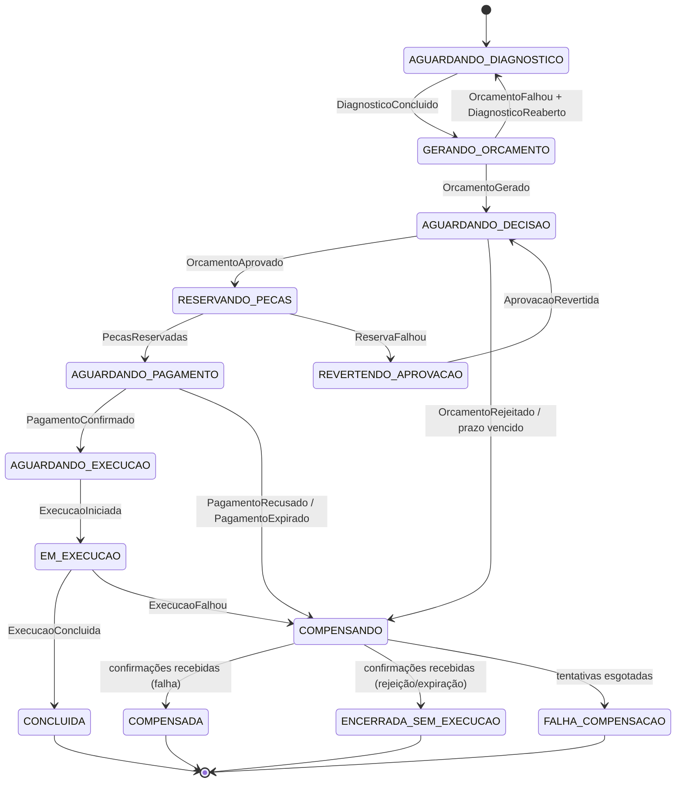

# ADR 0004 — Saga orquestrada pelo OS Service

- **Status:** Proposto
- **Data:** 2026-10-15
- **Contexto:** Tech Challenge SOAT 13 — Fase 4

## Contexto

Com a divisão do [ADR 0003](0003-divisao-em-microsservicos-e-dono-dos-dados.md), o
ciclo de vida de uma OS atravessa três serviços e três bancos: diagnóstico e
execução na Execution, orçamento e pagamento no Billing, status e histórico no OS.
Não existe mais transação única — e o enunciado exige o **Saga Pattern** com
rollback/compensação, documentado e justificado.

O fluxo tem características que pesam na escolha entre orquestração e coreografia:

- **seis passos** encadeados (diagnóstico → orçamento → decisão → reserva → pagamento → execução);
- **duas esperas longas por pessoas** (decisão do cliente e pagamento) e duas por mecânicos (diagnóstico e execução);
- **quatro caminhos de falha** com compensações diferentes (orçamento inválido, estoque insuficiente, pagamento recusado/expirado, execução abortada) e um encerramento de negócio (orçamento rejeitado ou vencido);
- compensações que **também podem falhar** (estorno recusado pelo Mercado Pago).

## Decisão

**Saga orquestrada, com o orquestrador dentro do OS Service.**

O OS é o dono do agregado cujo ciclo de vida a Saga coordena; o estado da Saga
fica no mesmo banco e na mesma transação que o status da OS. Billing e Execution
**não se conhecem por mensagens**: só recebem comandos do orquestrador e respondem
com eventos. Comunicação por SQS FIFO com outbox e idempotência
([ADR 0005](0005-sqs-fifo-outbox-e-idempotencia.md)); contratos em
[`../contratos/mensagens.md`](../contratos/mensagens.md).

### Por que orquestrada

- **Estado explícito.** Um componente sabe em que passo cada OS está. Na coreografia, esse estado fica implícito e espalhado em três serviços.
- **Compensação centralizada.** Quem decide o que desfazer é um único componente, testável de ponta a ponta com BDD.
- **Observabilidade e demonstração.** `GET /sagas/{ordemServicoId}` e a tabela `saga_passos` contam a história de cada Saga; o trace no Datadog parte de um só lugar.
- **Acoplamento controlado.** Acrescentar um passo muda um componente, não três.
- **Custo assumido:** o OS vira ponto central de coordenação. Mitigado com estado persistido, outbox, idempotência, réplicas e consumo por fila (se o OS cair, as respostas esperam na fila).

### Regra geral das mensagens

1. **Todo comando tem resposta imediata** — sucesso, falha ou confirmação (`DiagnosticoEnfileirado`, `OrcamentoGerado`/`OrcamentoFalhou`, `PecasReservadas`/`ReservaFalhou`…). É ela que o timeout de resposta vigia.
2. **Eventos de negócio posteriores chegam sem comando** — quando uma pessoa age (`DiagnosticoConcluido`, `OrcamentoAprovado`, `PagamentoConfirmado`, `ExecucaoConcluida`…). Esperas humanas não têm timeout, exceto decisão e pagamento.
3. **Evento inesperado para o estado atual é ignorado** e registrado em `saga_passos` como `EVENTO_IGNORADO` (ex.: `OrcamentoAprovado` depois de a Saga ter expirado a decisão).

### Passos

| # | Estado da Saga | Comando → participante | Resposta / evento | Efeito no OS |
|---|---|---|---|---|
| 1 | `AGUARDANDO_DIAGNOSTICO` | `EnfileirarDiagnostico` → Execution | `DiagnosticoEnfileirado` | OS `OS_ABERTA` |
| | | | `DiagnosticoIniciado` | `DIAGNOSTICO_EM_ANDAMENTO` |
| | | | `DiagnosticoConcluido` (serviços com mão de obra, peças) | `DIAGNOSTICO_CONCLUIDO` + snapshot do diagnóstico; Saga → `GERANDO_ORCAMENTO` |
| 2 | `GERANDO_ORCAMENTO` | `GerarOrcamento` → Billing | `OrcamentoGerado` | `AGUARDANDO_APROVACAO` + e-mail; Saga → `AGUARDANDO_DECISAO` |
| | | | `OrcamentoFalhou` (peça inexistente, preço indisponível) | Compensa: `ReabrirDiagnostico` → `DiagnosticoReaberto`; OS `DIAGNOSTICO_EM_ANDAMENTO`; Saga → `AGUARDANDO_DIAGNOSTICO` |
| 3 | `AGUARDANDO_DECISAO` | — (espera o cliente) | `OrcamentoAprovado` | Saga → `RESERVANDO_PECAS` |
| | | | `OrcamentoRejeitado` | **Encerramento de negócio:** OS `OS_FINALIZADA` motivo `ORCAMENTO_RECUSADO`; `CancelarExecucao`; Saga → `COMPENSANDO` (desfecho `ENCERRADA_SEM_EXECUCAO`) |
| | | | prazo de decisão vencido | OS `OS_FINALIZADA` motivo `ORCAMENTO_EXPIRADO`; `CancelarOrcamento` + `CancelarExecucao`; desfecho `ENCERRADA_SEM_EXECUCAO` |
| 4 | `RESERVANDO_PECAS` | `ReservarPecas` → Execution | `PecasReservadas` | `AGUARDANDO_PAGAMENTO`; Saga → `AGUARDANDO_PAGAMENTO` |
| | | | `ReservaFalhou` (peças faltantes) | Compensa: Saga → `REVERTENDO_APROVACAO`, `ReverterAprovacao` → `AprovacaoRevertida`; OS volta a `AGUARDANDO_APROVACAO` + e-mail; Saga → `AGUARDANDO_DECISAO`. Preserva a regra atual de `AprovarOrcamentoService` |
| 5 | `AGUARDANDO_PAGAMENTO` | `SolicitarPagamento` → Billing | `PagamentoSolicitado` (link) | Link guardado na Saga e enviado por e-mail |
| | | | `PagamentoConfirmado` | `AGUARDANDO_EXECUCAO`; Saga → `AGUARDANDO_EXECUCAO` |
| | | | `PagamentoRecusado` / `PagamentoExpirado` | OS `CANCELADA` motivo `PAGAMENTO_RECUSADO` / `PAGAMENTO_EXPIRADO`; `LiberarReserva` + `CancelarOrcamento` + `CancelarExecucao`; Saga → `COMPENSANDO` (desfecho `COMPENSADA`) |
| 6 | `AGUARDANDO_EXECUCAO` | `EnfileirarExecucao` → Execution | `ExecucaoEnfileirada` | — |
| | | | `ExecucaoIniciada` | `SERVICO_EM_ANDAMENTO`; Saga → `EM_EXECUCAO` |
| | `EM_EXECUCAO` | | `ExecucaoConcluida` (peças consumidas) | `OS_FINALIZADA` motivo `SERVICO_CONCLUIDO`; Saga → `CONCLUIDA` |
| | | | `ExecucaoFalhou` (mecânico aborta) | OS `CANCELADA` motivo `FALHA_EXECUCAO`; `EstornarPagamento` + `LiberarReserva`; Saga → `COMPENSANDO` (desfecho `COMPENSADA`) |
| — | (fora da Saga) | `POST /ordens-servico/{numero}/entrega` | | `ENTREGUE` |

### Compensação de cada passo

| Passo | Compensação | Confirmação |
|---|---|---|
| Diagnóstico / execução enfileirados | `CancelarExecucao` → Execution | `ExecucaoCancelada` |
| Orçamento gerado | `CancelarOrcamento` → Billing (cancela também pagamento pendente) | `OrcamentoCancelado` |
| Orçamento gerado com erro | `ReabrirDiagnostico` → Execution | `DiagnosticoReaberto` |
| Aprovação do cliente | `ReverterAprovacao` → Billing | `AprovacaoRevertida` |
| Peças reservadas | `LiberarReserva` → Execution (só o que não foi consumido) | `ReservaLiberada` |
| Pagamento confirmado | `EstornarPagamento` → Billing → refund no Mercado Pago (cancela também o orçamento) | `PagamentoEstornado` / `EstornoFalhou` |

Em `COMPENSANDO`, a Saga guarda em `compensacoes_pendentes` as confirmações que
faltam e em `desfecho` o estado final (`COMPENSADA` ou
`ENCERRADA_SEM_EXECUCAO`). Chegou a última confirmação → estado final. O status da
OS muda **no momento da decisão** (não espera as confirmações), porque para o
cliente o desfecho já está definido.

**Compensação que falha** (`EstornoFalhou` ou falta de resposta): reenvio com
backoff, até 3 tentativas. Esgotou → Saga em `FALHA_COMPENSACAO`, monitor no
Datadog e ação manual. É o único estado que exige gente.

### Máquina de estados



### Timeouts

| Espera | hml | prd | Ao vencer |
|---|---|---|---|
| Resposta imediata a um comando | 5 min | 5 min | Reenvia (novo `messageId`, mesmo comando) até 3 vezes. Esgotou: comando de avanço → trata como falha do passo; comando de compensação → `FALHA_COMPENSACAO` |
| Decisão do cliente | 15 min | `validade` do orçamento | Caminho `ORCAMENTO_EXPIRADO` |
| Pagamento | 30 min | 24 h | O **Billing** é a autoridade: emite `PagamentoExpirado`. O OS só age se nada chegar até o prazo + 10 min (rede de segurança: trata como expirado) |

Um `SagaTimeoutScheduler` roda a cada 30 s e busca `saga_instancia` com
`prazo_expira_em < now()` e status não final. Todos os prazos vêm de variáveis de
ambiente (`SAGA_TIMEOUT_RESPOSTA`, `SAGA_PRAZO_DECISAO`, `SAGA_PRAZO_PAGAMENTO`),
curtos em hml para a demonstração.

### Persistência (OS Service)

```sql
CREATE TABLE saga_instancia (
    id                  uuid PRIMARY KEY,
    ordem_de_servico_id uuid        NOT NULL UNIQUE REFERENCES ordens_de_servico(id),
    status              varchar(40) NOT NULL,
    passo_atual         varchar(60) NOT NULL,
    orcamento_id        uuid,
    pagamento_id        uuid,
    desfecho            varchar(40),                       -- estado final quando as compensações terminarem
    motivo              varchar(255),
    compensacoes_pendentes varchar(255),                    -- confirmações que faltam chegar
    prazo_expira_em     timestamp,
    tentativas_passo    int         NOT NULL DEFAULT 0,
    versao              bigint      NOT NULL DEFAULT 0,     -- lock otimista
    criada_em           timestamp   NOT NULL,
    atualizada_em       timestamp   NOT NULL
);

CREATE TABLE saga_passos (
    id           bigserial PRIMARY KEY,
    saga_id      uuid        NOT NULL REFERENCES saga_instancia(id),
    passo        varchar(60) NOT NULL,
    tipo         varchar(20) NOT NULL,  -- COMANDO_ENVIADO, EVENTO_RECEBIDO, EVENTO_IGNORADO, COMPENSACAO, TIMEOUT
    mensagem_id  uuid,
    detalhe      varchar(2000),
    ocorrido_em  timestamp   NOT NULL
);

-- Colunas tipadas em vez de um jsonb "dados": são poucos campos, todos lidos pelo agendador
-- e por GET /sagas/{ordemServicoId} (implementado na migration V23).

CREATE TABLE ordem_servico_historico (
    id                  bigserial PRIMARY KEY,
    ordem_de_servico_id uuid        NOT NULL REFERENCES ordens_de_servico(id) ON DELETE CASCADE,
    status_anterior     varchar(40),
    status_novo         varchar(40) NOT NULL,
    origem              varchar(60) NOT NULL,  -- API, EVENTO, SAGA, TIMEOUT
    saga_id             uuid,
    ocorrido_em         timestamp   NOT NULL
);
```

Cada evento é tratado numa transação só: lê a Saga (com `versao`), muda a OS, grava
histórico, avança a Saga, grava os próximos comandos no outbox e registra o
`messageId` em `mensagens_processadas`. Conflito de versão (consumidor × scheduler
de timeout) → a transação é refeita.

### Novos status da OS

| `StatusOrdemDeServico` | Situação externa | Novo? |
|---|---|---|
| `OS_ABERTA` | Recebida | — |
| `DIAGNOSTICO_EM_ANDAMENTO`, `DIAGNOSTICO_CONCLUIDO` | Diagnóstico | — |
| `AGUARDANDO_APROVACAO` | Aguardando Aprovação | — (`ORCAMENTO_GERADO` sai: vira estado da Saga) |
| `AGUARDANDO_PAGAMENTO` | Aguardando Pagamento | **novo** |
| `AGUARDANDO_EXECUCAO`, `SERVICO_EM_ANDAMENTO` | Execução | `AGUARDANDO_EXECUCAO` **novo** |
| `OS_FINALIZADA` | Finalizada | — |
| `ENTREGUE` | Entregue | — |
| `CANCELADA` | Cancelada | **novo** |

`MotivoEncerramento` ganha `ORCAMENTO_EXPIRADO`, `PAGAMENTO_RECUSADO`,
`PAGAMENTO_EXPIRADO` e `FALHA_EXECUCAO`. `StatusOrcamento` ganha `CANCELADO`.

### Como provocar cada falha (demonstração e BDD)

| Cenário | Como provocar |
|---|---|
| Orçamento inválido | Diagnóstico com `pecaInsumoId` inexistente |
| Estoque insuficiente | Peça com estoque 0, ou quantidade prevista maior que o disponível |
| Pagamento recusado | Cartão de teste com titular `OTHE` ([ADR 0007](0007-mercado-pago-checkout-pro.md)) |
| Pagamento expirado | `SAGA_PRAZO_PAGAMENTO` de 1–2 min em hml e não pagar |
| Execução abortada | `POST /execucoes/{ordemServicoId}/abortar` |
| Resiliência | `kubectl delete pod` do Billing no meio da Saga: a mensagem espera na fila |

## Alternativas consideradas

| Alternativa | Por que não |
|---|---|
| **Coreografia** (cada serviço reage aos eventos dos outros) | Com 6 passos, 2 esperas longas e 4 tipos de compensação, o estado da Saga ficaria implícito em três serviços; cada novo passo exigiria mudar vários consumidores; e não haveria um lugar para consultar "onde está esta OS" nem para aplicar timeouts. Funciona bem para fluxos curtos e lineares — não é o caso. |
| **Orquestrador em serviço próprio** | Isolaria a coordenação, mas acrescentaria um quarto serviço e separaria o estado da Saga do estado da OS, exigindo outra Saga para mantê-los coerentes. |
| **Motor de workflow** (Temporal, Camunda, Step Functions) | Resolveria timeouts e reprocessamento, mas é mais um componente para operar (ou custo e acoplamento à AWS) e esconderia exatamente o que a disciplina quer ver implementado. |
| **Two-phase commit / XA** | Bloqueia recursos durante esperas humanas de horas, não existe entre PostgreSQL e DynamoDB e não atravessa o Mercado Pago. |
| **Pagamento na entrega** | Mais realista para oficina, mas a Saga perderia a compensação de pagamento (estorno), justamente a mais interessante de demonstrar. |

## Consequências

**Positivas**

- Estado de cada OS consultável em um lugar (`GET /sagas/{ordemServicoId}`, `GET /ordens-servico/{numero}/historico`).
- Compensações e timeouts testáveis com Cucumber sem rede, primeiro com adapter em memória (Passo 1) e depois com LocalStack.
- Participantes simples: um consumidor de comandos e um publicador de eventos, sem conhecer o fluxo.

**Negativas e mitigações**

- **Ponto central de coordenação.** Estado persistido + outbox + filas: se o OS cair, nada se perde, só atrasa.
- **Consistência eventual visível ao usuário** (a OS muda de situação alguns segundos depois da ação). Explicado no README; BDD usa Awaitility.
- **Mais estados na OS.** Mapeamento em `SituacaoOrdemDeServico.fromStatus`, métricas de tempo médio e dashboard precisam ser atualizados.
- **`FALHA_COMPENSACAO` exige ação manual.** Aceito: é raro (estorno recusado repetidamente) e monitorado.

## Relacionado

- [ADR 0003](0003-divisao-em-microsservicos-e-dono-dos-dados.md) — divisão e dono dos dados
- [ADR 0005](0005-sqs-fifo-outbox-e-idempotencia.md) — mensageria, outbox e idempotência
- [ADR 0007](0007-mercado-pago-checkout-pro.md) — pagamento e estorno
- [`../contratos/mensagens.md`](../contratos/mensagens.md) — comandos, eventos e payloads
