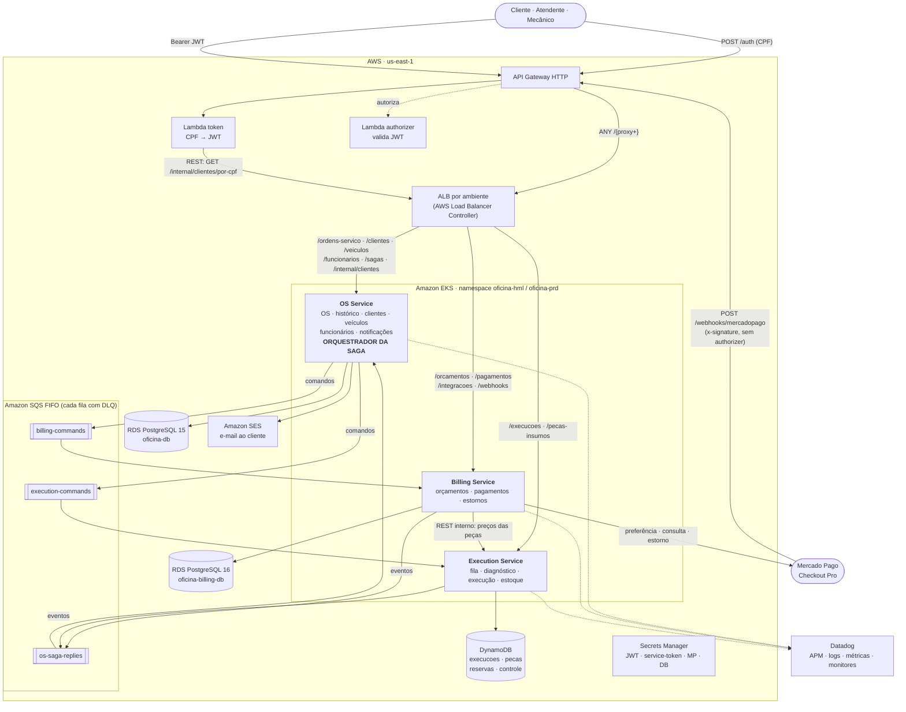
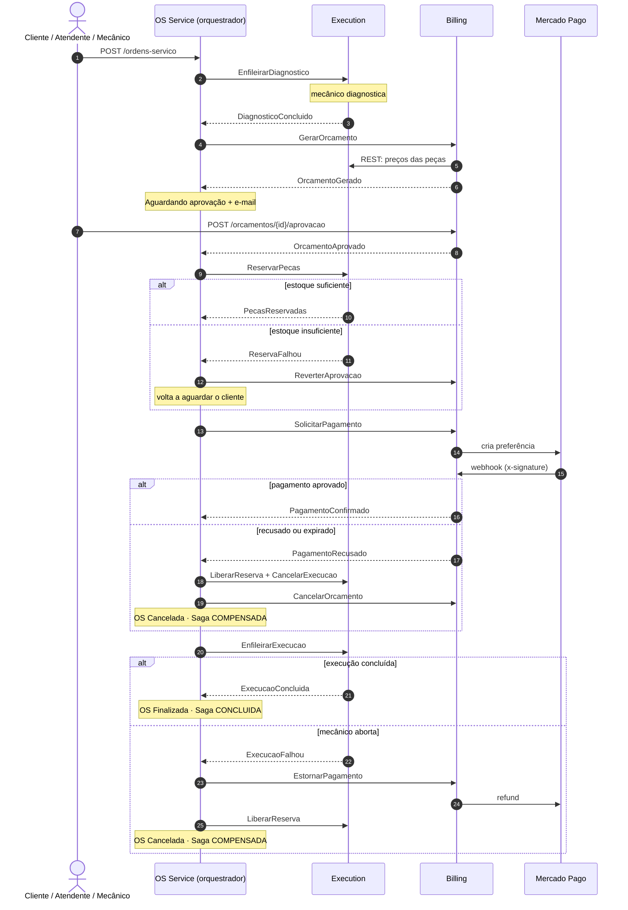
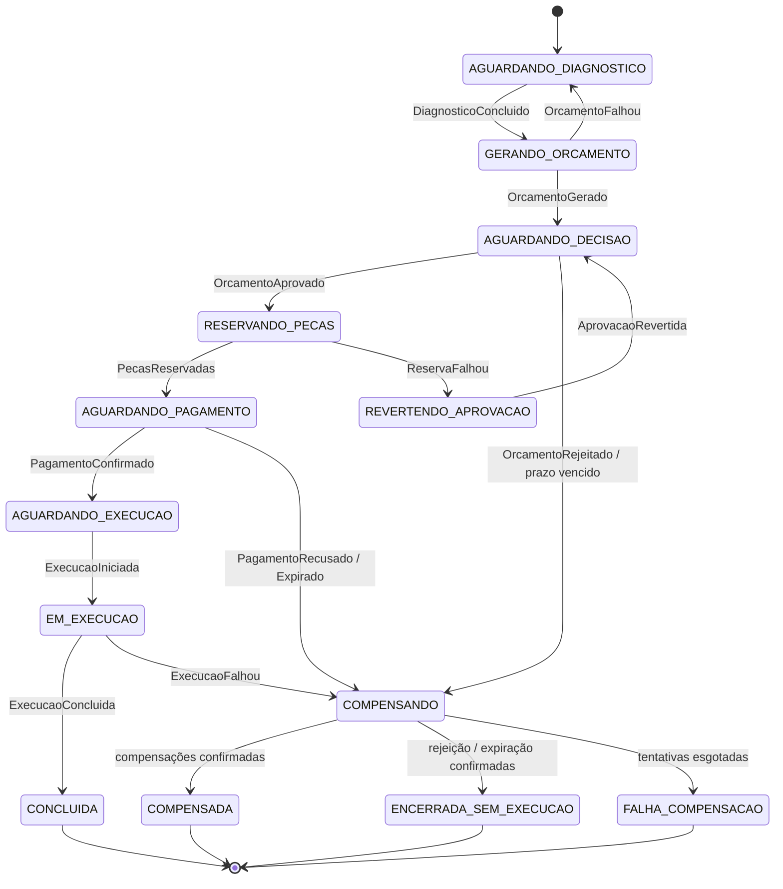

# Arquitetura final — Fase 4

> **Tech Challenge SOAT 13 — Oficina Mecânica.** Texto de entrega da Fase 4 (PDF do portal):
> diagrama geral da arquitetura final, estratégia do Saga Pattern e justificativa da divisão dos
> microsserviços e das tecnologias. Os detalhes de cada decisão estão nos ADRs
> [0003](../adr/0003-divisao-em-microsservicos-e-dono-dos-dados.md) a
> [0008](../adr/0008-exposicao-e-roteamento.md).

## Repositórios

| Repositório | Papel |
|---|---|
| [`oficina-app`](https://github.com/soat13-oficina/oficina-app) | **OS Service**: ordem de serviço, cadastros, notificações e **orquestrador da Saga** |
| [`oficina-billing-service`](https://github.com/soat13-oficina/oficina-billing-service) | **Billing Service**: orçamentos, pagamentos (Mercado Pago) e estornos |
| [`oficina-execution-service`](https://github.com/soat13-oficina/oficina-execution-service) | **Execution Service**: fila, diagnóstico, execução e estoque de peças |
| [`oficina-lambda-auth`](https://github.com/soat13-oficina/oficina-lambda-auth) | API Gateway, Lambda de login por CPF e Lambda Authorizer |
| [`oficina-infra-k8s`](https://github.com/soat13-oficina/oficina-infra-k8s) | Plataforma: VPC, EKS, AWS Load Balancer Controller e Datadog |
| [`oficina-infra-database`](https://github.com/soat13-oficina/oficina-infra-database) | RDS PostgreSQL do OS Service |

Cada microsserviço tem repositório, pipeline, imagem (ECR), infraestrutura (`infra/` em Terraform)
e banco próprios.

---

## 1. Diagrama geral da arquitetura final

### Serviços e bancos

| Serviço | Responsabilidade | Banco | Dados (dono exclusivo) |
|---|---|---|---|
| **OS Service** | Abertura, consulta, status, histórico e entrega da OS; clientes, veículos e funcionários; login de funcionários; e-mails de acompanhamento; **orquestração da Saga** | PostgreSQL 15 (RDS `oficina-db-<env>`) | `ordens_de_servico`, `ordem_servico_historico`, `clientes`, `veiculos`, `funcionarios`, `usuarios`, `notificacoes`, `saga_instancia`, `saga_passos`, `outbox_mensagens`, `mensagens_processadas` |
| **Billing Service** | Geração, alteração, aprovação e rejeição do orçamento; webhook de decisão; cobrança no Mercado Pago; webhook de pagamento; estorno | PostgreSQL 16 (RDS `oficina-billing-db-<env>`) | `orcamentos` (+ serviços e peças previstos), `pagamentos`, `tokens_integracao`, `outbox_mensagens`, `mensagens_processadas` |
| **Execution Service** | Fila de diagnóstico e de execução, diagnóstico, início, conclusão e aborto da execução; catálogo e estoque de peças; reserva, liberação e consumo | DynamoDB (on-demand) | `execucoes` (GSI `fila-por-etapa`), `pecas`, `reservas`, `execution-controle` (idempotência + outbox, TTL de 7 dias) |

**Nenhum serviço acessa o banco de outro.** O que um serviço precisa do outro chega por mensagem
(snapshot dentro do comando) ou por uma chamada REST interna. Isso vale também para a Lambda de
login, que deixou de ler a tabela `clientes` e passou a consultar o OS Service por HTTP.

### Comunicação

**Síncrona (REST)** — só onde a resposta é necessária na hora:

| Chamador → chamado | Endpoint | Por que síncrono |
|---|---|---|
| Lambda `token` → OS | `GET /internal/clientes/por-cpf/{cpf}` | O login por CPF precisa da resposta para emitir o JWT |
| Billing → Execution | `POST /internal/pecas-insumos/consulta` (pelo DNS do cluster, fora do ALB) | O orçamento precisa do preço das peças no momento em que é criado |
| Billing → Mercado Pago | API de Preferences, Payments e Refunds | Integração externa |

Os caminhos `/internal/**` exigem o header `X-Service-Token` (segredo no Secrets Manager, comparação
em tempo constante) e não são publicados no API Gateway. Timeout curto (2–3 s) e propagação do
`x-request-id`.

**Assíncrona (Amazon SQS FIFO)** — todos os comandos e eventos da Saga:

| Fila (`oficina-<env>-…`) | Produtor | Consumidor | Conteúdo |
|---|---|---|---|
| `billing-commands.fifo` + DLQ | OS (orquestrador) | Billing | `GerarOrcamento`, `SolicitarPagamento`, `ReverterAprovacao`, `CancelarOrcamento`, `EstornarPagamento` |
| `execution-commands.fifo` + DLQ | OS (orquestrador) | Execution | `EnfileirarDiagnostico`, `ReabrirDiagnostico`, `ReservarPecas`, `LiberarReserva`, `EnfileirarExecucao`, `CancelarExecucao` |
| `os-saga-replies.fifo` + DLQ | Billing, Execution | OS (orquestrador) | Eventos de resposta (`OrcamentoGerado`, `PecasReservadas`, `PagamentoConfirmado`, `ExecucaoConcluida`, `ReservaFalhou`, `PagamentoEstornado`…) |

- `MessageGroupId = ordemServicoId`: mensagens da mesma OS chegam em ordem; OSs diferentes andam em paralelo.
- `MessageDeduplicationId = messageId`: deduplicação nativa do SQS.
- Depois de 5 recebimentos sem sucesso, a mensagem vai para a DLQ, que é monitorada no Datadog.
- Todas as mensagens usam o mesmo envelope (`messageId`, `type`, `version`, `sagaId`,
  `ordemServicoId`, `correlationId`, `occurredAt`, `source`, `payload`), validado por JSON Schema
  ([contratos](../contratos/mensagens.md)).

### Entrada e segurança

- **API Gateway HTTP** é a porta única. `POST /auth` chama a Lambda `token`, que valida o CPF,
  consulta o cliente no OS e emite um JWT (HS256). As demais rotas passam pelo **Lambda Authorizer**
  e seguem para o ALB. A exceção é `POST /webhooks/mercadopago`: não tem authorizer e é protegida pela
  assinatura `x-signature` do Mercado Pago, conferida no Billing.
- **Um ALB por ambiente**, criado pelo AWS Load Balancer Controller a partir dos `Ingress` dos três
  serviços (IngressGroup). O deploy grava o hostname do ALB no SSM Parameter Store, e o Terraform do
  gateway lê de lá.
- Cada serviço valida o JWT por conta própria (mesmo segredo), e cada um tem a própria role IAM
  (IRSA). Cada role só pode publicar nas filas que o serviço produz, consumir das que ele consome e
  acessar o próprio banco.

---

## 2. Estratégia do Saga Pattern: **orquestração**

### Decisão

A Saga é **orquestrada**, e o orquestrador fica **dentro do OS Service**. A ordem de serviço é o
agregado cujo ciclo de vida a Saga coordena, então o estado da Saga fica no mesmo banco e na mesma
transação que o status da OS. Billing e Execution **não se conhecem por mensagens**: só recebem
comandos do orquestrador e respondem com eventos.

### Por que orquestração, e não coreografia

O fluxo da oficina tem **seis passos encadeados** (diagnóstico → orçamento → decisão do cliente →
reserva de peças → pagamento → execução), **esperas longas por pessoas** (cliente decidindo, cliente
pagando, mecânico trabalhando) e **quatro caminhos de falha com compensações diferentes**. Com esse
perfil:

- **O estado fica explícito.** Um único componente sabe em que passo cada OS está (`saga_instancia`).
  Na coreografia, esse estado ficaria implícito e espalhado em três serviços.
- **A compensação fica centralizada.** Quem decide o que desfazer é um só componente, testado de
  ponta a ponta com BDD (Cucumber).
- **Os timeouts têm dono.** Prazo de decisão do cliente, prazo de pagamento e falta de resposta a um
  comando são vigiados por um agendador do orquestrador. Na coreografia, ninguém seria responsável
  por perceber que "nada aconteceu".
- **Rastreabilidade.** `GET /sagas/{ordemServicoId}` e a tabela `saga_passos` contam a história de
  cada Saga (comandos enviados, eventos recebidos, compensações e timeouts), e o trace no Datadog parte
  de um só lugar.
- **Acoplamento controlado.** Acrescentar ou reordenar um passo muda um componente, não três. Os
  participantes ficam simples: consomem comandos e publicam eventos sem conhecer o fluxo.

**Custo assumido:** o OS Service vira o ponto central de coordenação. Mitigamos com estado
persistido, outbox transacional, idempotência e consumo por fila: se o OS cair, as respostas esperam
na fila e a Saga continua de onde parou.

**Alternativas descartadas:** coreografia (pelos motivos acima, serve melhor para fluxos curtos e
lineares); orquestrador em serviço próprio (um quarto serviço e o estado da Saga separado do estado da
OS); motor de workflow (Step Functions, Temporal, Camunda: mais um componente para operar e esconderia
o que a disciplina quer ver implementado); two-phase commit (bloqueia recursos durante esperas de
horas e não existe entre PostgreSQL, DynamoDB e Mercado Pago).

### Passos, falhas e compensações

| # | Passo | Comando → participante | Sucesso | Falha | Compensação |
|---|---|---|---|---|---|
| 1 | Diagnóstico | `EnfileirarDiagnostico` → Execution | `DiagnosticoConcluido` (serviços e peças) | — | — |
| 2 | Orçamento | `GerarOrcamento` → Billing | `OrcamentoGerado` → OS *Aguardando aprovação* + e-mail | `OrcamentoFalhou` (peça inexistente) | `ReabrirDiagnostico` → OS volta ao diagnóstico |
| 3 | Decisão do cliente | (espera) | `OrcamentoAprovado` | `OrcamentoRejeitado` ou prazo vencido | `CancelarExecucao` (+ `CancelarOrcamento` se venceu) → OS *Finalizada* sem execução |
| 4 | Reserva de peças | `ReservarPecas` → Execution | `PecasReservadas` → OS *Aguardando pagamento* | `ReservaFalhou` (estoque insuficiente) | `ReverterAprovacao` → orçamento volta a aguardar o cliente |
| 5 | Pagamento (Mercado Pago) | `SolicitarPagamento` → Billing | `PagamentoConfirmado` → OS *Aguardando execução* | `PagamentoRecusado` / `PagamentoExpirado` | `LiberarReserva` + `CancelarOrcamento` + `CancelarExecucao` → OS *Cancelada* |
| 6 | Execução | `EnfileirarExecucao` → Execution | `ExecucaoConcluida` (baixa do estoque) → OS *Finalizada* | `ExecucaoFalhou` (mecânico aborta) | `EstornarPagamento` (refund no Mercado Pago) + `LiberarReserva` → OS *Cancelada* |

A entrega do veículo (`POST /ordens-servico/{numero}/entrega`) fica fora da Saga.

**Compensação que falha** (por exemplo, estorno recusado): reenvio com backoff, até 3 tentativas.
Esgotou, a Saga vai para `FALHA_COMPENSACAO`, um monitor do Datadog dispara e a correção é manual. É o
único estado que exige uma pessoa.

### Fluxo (caminho feliz e compensações)

### Máquina de estados da Saga

### Garantias que sustentam a Saga

| Problema | Solução |
|---|---|
| Gravar no banco e publicar na fila não é atômico | **Outbox transacional**: a mensagem é gravada na mesma transação da mudança de estado (`outbox_mensagens` no PostgreSQL; item de outbox no mesmo `TransactWriteItems` no DynamoDB). Um publicador envia ao SQS a cada 1 s |
| O SQS entrega "pelo menos uma vez" | **Idempotência**: cada consumidor grava o `messageId` em `mensagens_processadas` (ou faz um `Put` condicional no DynamoDB) na mesma transação do efeito; mensagem repetida é confirmada sem efeito |
| Mensagens da mesma OS fora de ordem | **SQS FIFO** com `MessageGroupId = ordemServicoId` |
| Participante que não responde | **Timeout de resposta**: o orquestrador reenvia o comando até 3 vezes e, depois disso, trata como falha do passo |
| Cliente que não decide ou não paga | **Prazos de decisão e de pagamento** (variáveis de ambiente; curtos em homologação) |
| Reserva de estoque concorrente | **Escrita condicional** no DynamoDB (`quantidadeDisponivel >= q`) dentro de uma transação: ou reserva tudo ou nada |
| Consumidor e agendador mexendo na mesma Saga | **Lock otimista** (`versao`) em `saga_instancia` |
| Mensagem que nunca é processada | **DLQ** por fila, com monitor no Datadog |

---

## 3. Justificativa da divisão dos microsserviços

**Divisão por capacidade de negócio**, seguindo o próprio funcionamento da oficina: **atendimento**
(OS Service), **cobrança** (Billing Service) e **produção** (Execution Service). Cada serviço tem dados
que só ele altera e um motivo próprio para mudar.

- **OS Service — atendimento e coordenação.** O cliente, o veículo e a ordem de serviço não têm
  ciclo de vida fora do atendimento, então ficam juntos. O OS também é dono da visão que o cliente
  acompanha (status e histórico) e, por isso, é o lugar natural do orquestrador: o estado da Saga e o
  status da OS mudam na mesma transação.
- **Billing Service — dinheiro.** Orçamento e pagamento ficam juntos porque o orçamento é o documento
  que gera a cobrança. Separá-los criaria mais uma Saga entre serviços. O Billing concentra a
  integração com o Mercado Pago, o webhook e o estorno, isolando o resto do sistema de um provedor
  externo.
- **Execution Service — chão de oficina.** Fila, diagnóstico, execução e estoque ficam juntos porque
  a reserva de peças está presa à execução: consome-se na conclusão exatamente o que foi reservado
  para aquela OS. É o serviço com o padrão de acesso mais diferente (por chave e por fila), o que
  justifica um banco NoSQL.

**Divisões descartadas:** um serviço por módulo do monólito (sete serviços para dados sem ciclo de
vida próprio); estoque num quarto serviço (mais um pipeline e mais custo, e a reserva ficaria
separada da execução que a consome); diagnóstico no OS (deixaria a Execution magra demais para ser um
serviço).

A extração partiu do monólito hexagonal da Fase 3. Primeiro os módulos foram desacoplados **dentro do
monólito**, com portas de mensageria em memória, a Saga completa e regras de ArchUnit proibindo
imports entre os módulos que virariam serviços. Depois Billing e Execution foram extraídos, trocando
o adapter em memória por SQS e REST.

## 4. Justificativa das tecnologias

| Tecnologia | Onde | Por quê |
|---|---|---|
| **Java 21 + Spring Boot 4.0.5**, arquitetura hexagonal | Os três serviços | Mesma base da Fase 3: extrair um módulo virou mover o pacote e trocar os adapters. Uma única stack facilita a manutenção pelo grupo |
| **PostgreSQL (Amazon RDS)** | OS (15) e Billing (16) | O OS herda o modelo relacional da Fase 3 (OS × cliente × veículo × histórico). No Billing, dinheiro pede transações ACID, constraints e consultas relacionais (orçamento × pagamentos × estornos) |
| **Amazon DynamoDB** | Execution | Acesso por chave (OS, peça) e fila por etapa via índice secundário; decremento de estoque atômico com escrita condicional e transações; sem servidor para operar e custo quase zero no volume do projeto. Cumpre o requisito de um banco NoSQL com motivo de domínio |
| **Amazon SQS FIFO + DLQ** | Comandos e eventos da Saga | Gerenciado, integrado ao IAM (IRSA) e ao Terraform, com ordem por OS, deduplicação nativa e DLQ. Evita operar RabbitMQ ou Kafka dentro do cluster. LocalStack no desenvolvimento local |
| **REST síncrono** | Lambda → OS, Billing → Execution | Só onde a resposta é necessária na hora (login, preço da peça) |
| **Amazon EKS + AWS Load Balancer Controller** | Execução dos serviços | Plataforma da Fase 3, agora com um ALB por ambiente compartilhado pelos três serviços e roteamento por caminho. HPA por CPU e memória em cada serviço |
| **API Gateway HTTP + AWS Lambda (Node 22)** | Entrada e autenticação | Login por CPF e autorização por JWT fora dos serviços, num único ponto de entrada |
| **Mercado Pago Checkout Pro** (SDK Java) | Billing | Exigido pelo enunciado. Preferência com `external_reference`, webhook com `x-signature` conferido na API e estorno com chave de idempotência |
| **AWS Secrets Manager + SSM Parameter Store** | Segredos e descoberta | JWT, service-token, credenciais do Mercado Pago e do banco fora do código; endereço do ALB descoberto sem edição manual |
| **Terraform** | `infra/` de cada serviço + repositórios de infraestrutura | Infraestrutura própria por serviço (banco, filas, ECR, role IAM), com workspaces `hml`/`prd` |
| **GitHub Actions** | Pipeline de cada repositório | Testes → qualidade (SonarCloud) → build (ECR) → deploy no EKS → healthcheck. Repositórios protegidos: PR obrigatório e checagens |
| **JUnit 5, Testcontainers, Cucumber, JaCoCo, SonarCloud** | Qualidade | Cobertura mínima de 80% por serviço (gate do JaCoCo); BDD cobrindo a Saga (fluxo completo e compensações); quality gate no CI |
| **Datadog** | Observabilidade | APM com trace atravessando as filas, logs JSON correlacionados por `correlationId`/`sagaId`, métricas da Saga, do pagamento, do estoque, do outbox e das DLQs, dashboard e monitores |
