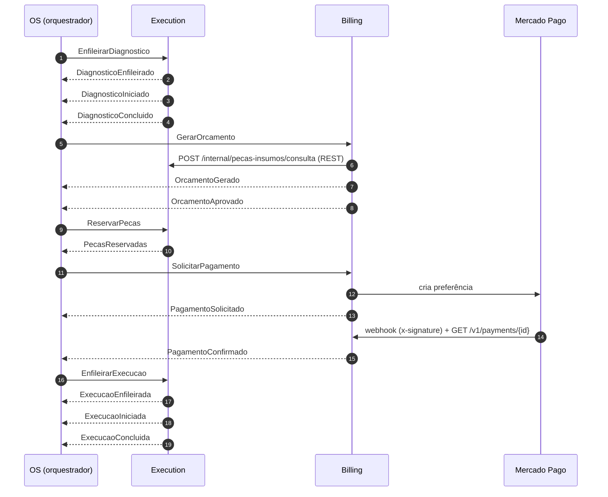

# Contratos de mensagens da Saga

> **Fonte da verdade:** este arquivo e os JSON Schemas em [`schemas/`](schemas/), no
> repositório `oficina-app` (OS Service, dono da Saga). Billing e Execution copiam os
> schemas das mensagens que produzem e consomem e os usam em testes de contrato.
> Mudou um contrato → PR aqui primeiro.

Decisões que sustentam este documento: [ADR 0004](../adr/0004-saga-orquestrada.md)
(Saga orquestrada) e [ADR 0005](../adr/0005-sqs-fifo-outbox-e-idempotencia.md)
(SQS FIFO, outbox e idempotência).

## Transporte

| Fila (SQS FIFO, prefixo `oficina-<env>-`) | Produtor | Consumidor | Conteúdo |
|---|---|---|---|
| `billing-commands.fifo` (+ `-dlq.fifo`) | OS | Billing | Comandos para o Billing |
| `execution-commands.fifo` (+ `-dlq.fifo`) | OS | Execution | Comandos para a Execution |
| `os-saga-replies.fifo` (+ `-dlq.fifo`) | Billing, Execution | OS | Todos os eventos |

| Atributo SQS | Valor |
|---|---|
| `MessageGroupId` | `ordemServicoId` do envelope |
| `MessageDeduplicationId` | `messageId` do envelope |
| Message attributes | `type` (String), `version` (Number), `correlationId` (String) |
| Corpo | Envelope JSON (UTF-8) |

## Envelope

Schema: [`schemas/envelope.schema.json`](schemas/envelope.schema.json).

```json
{
  "messageId": "00000000-0000-4000-8000-000000000007",
  "type": "GerarOrcamento",
  "version": 1,
  "sagaId": "6f0e2b8a-1c3d-4e5f-8a9b-0c1d2e3f4a5b",
  "ordemServicoId": "3c9a1b2d-4e5f-4a7b-8c9d-0e1f2a3b4c5d",
  "correlationId": "Yx2kLh1MIAMEJbQ=",
  "causationId": null,
  "occurredAt": "2026-10-15T13:00:00Z",
  "source": "oficina-os-service",
  "payload": { }
}
```

| Campo | Regra |
|---|---|
| `messageId` | UUID único por mensagem. Comando **reenviado** por timeout ganha `messageId` novo |
| `type`, `version` | Nome e versão do contrato. Mudança incompatível incrementa `version` |
| `sagaId`, `ordemServicoId` | Identificam a Saga e a OS; `ordemServicoId` também é o grupo FIFO |
| `correlationId` | `x-request-id` do API Gateway, de ponta a ponta (logs, MDC, traces) |
| `causationId` | `messageId` do comando que originou o evento. `null` em comandos e em eventos espontâneos |
| `occurredAt` | Instante do fato, ISO-8601 UTC |
| `source` | `oficina-os-service`, `oficina-billing-service` ou `oficina-execution-service` |

## Convenções

- **Dinheiro** como texto com duas casas: `"530.00"` — nunca número de ponto flutuante. Em Java, `BigDecimal` com `@JsonFormat(shape = STRING)`.
- **Datas** ISO-8601 em UTC com `Z`.
- **Ids** em UUID, exceto `pecaInsumoId` (texto até 255, como hoje) e `mpPaymentId`/`mpRefundId` (ids do Mercado Pago, texto).
- **Leitor tolerante:** consumidores ignoram campos desconhecidos (`FAIL_ON_UNKNOWN_PROPERTIES = false`). Acrescentar campo opcional **não** muda `version`; remover, renomear ou mudar tipo **muda**.
- **Nomes:** `type` em PascalCase; comandos no imperativo (`ReservarPecas`), eventos no particípio (`PecasReservadas`); campos em camelCase e em português, como o domínio.
- **Toda resposta a um comando** carrega `causationId`. Eventos espontâneos — ação de pessoa (mecânico, cliente), webhook do Mercado Pago ou prazo vencido no Billing — têm `causationId = null`.

## Catálogo

Cada linha aponta para o schema da mensagem completa (envelope + payload), que traz
um exemplo válido em `examples`. Campo com `?` é opcional.

### Comandos (OS → participantes)

#### Para Execution — fila `execution-commands`

| Comando | Tipo | Payload | Respostas |
|---|---|---|---|
| [`EnfileirarDiagnostico`](schemas/comandos/EnfileirarDiagnostico.schema.json) | avanço | `numeroOrdemServico`, `veiculo`, `servicosPrevistos`?, `pecasPrevistas`?, `abertaEm` | `DiagnosticoEnfileirado` |
| [`ReabrirDiagnostico`](schemas/comandos/ReabrirDiagnostico.schema.json) | compensação | `motivo`, `pecasInvalidas`? | `DiagnosticoReaberto` |
| [`ReservarPecas`](schemas/comandos/ReservarPecas.schema.json) | avanço | `orcamentoId`, `itens` | `PecasReservadas`, `ReservaFalhou` |
| [`EnfileirarExecucao`](schemas/comandos/EnfileirarExecucao.schema.json) | avanço | `orcamentoId` | `ExecucaoEnfileirada` |
| [`LiberarReserva`](schemas/comandos/LiberarReserva.schema.json) | compensação | `motivo` | `ReservaLiberada` |
| [`CancelarExecucao`](schemas/comandos/CancelarExecucao.schema.json) | compensação | `motivo` | `ExecucaoCancelada` |

#### Para Billing — fila `billing-commands`

| Comando | Tipo | Payload | Respostas |
|---|---|---|---|
| [`GerarOrcamento`](schemas/comandos/GerarOrcamento.schema.json) | avanço | `numeroOrdemServico`, `cliente`, `veiculo`, `funcionario`, `descricaoDiagnostico`, `servicos`, `pecas`, `valorMaoDeObra`?, `desconto`?, `validade`?, `observacoes`? (¹) | `OrcamentoGerado`, `OrcamentoFalhou` |
| [`SolicitarPagamento`](schemas/comandos/SolicitarPagamento.schema.json) | avanço | `orcamentoId`, `expiraEm` | `PagamentoSolicitado` |
| [`ReverterAprovacao`](schemas/comandos/ReverterAprovacao.schema.json) | compensação | `orcamentoId`, `motivo`, `pecasFaltantes`? | `AprovacaoRevertida` |
| [`CancelarOrcamento`](schemas/comandos/CancelarOrcamento.schema.json) | compensação | `orcamentoId`, `motivo` | `OrcamentoCancelado` |
| [`EstornarPagamento`](schemas/comandos/EstornarPagamento.schema.json) | compensação | `orcamentoId`, `pagamentoId`, `motivo` | `PagamentoEstornado`, `EstornoFalhou` |

(¹) Transitório, enquanto o diagnóstico mora no OS Service (Fase 4, Passo 1): o atendente ainda
informa no envio para orçamento a mão de obra total, o desconto, a validade e as observações, e
`servicos[].valorMaoDeObra` pode faltar. Sem esses campos o Billing usa a soma da mão de obra dos
serviços, desconto zero e a validade padrão (7 dias). Com a Execution (Passo 4) o comando sai só com
os campos obrigatórios.

### Eventos (participantes → OS) — fila `os-saga-replies`

#### Da Execution

| Evento | Em resposta a | Payload |
|---|---|---|
| [`DiagnosticoEnfileirado`](schemas/eventos/DiagnosticoEnfileirado.schema.json) | `EnfileirarDiagnostico` | `posicaoNaFila` |
| [`DiagnosticoIniciado`](schemas/eventos/DiagnosticoIniciado.schema.json) | — (mecânico) | `mecanico`, `iniciadoEm` |
| [`DiagnosticoConcluido`](schemas/eventos/DiagnosticoConcluido.schema.json) | — (mecânico) | `mecanico`, `descricaoDiagnostico`, `servicos`, `pecas`, `concluidoEm` |
| [`DiagnosticoReaberto`](schemas/eventos/DiagnosticoReaberto.schema.json) | `ReabrirDiagnostico` | `reabertoEm` |
| [`PecasReservadas`](schemas/eventos/PecasReservadas.schema.json) | `ReservarPecas` | `orcamentoId`, `itens` |
| [`ReservaFalhou`](schemas/eventos/ReservaFalhou.schema.json) | `ReservarPecas` | `orcamentoId`, `faltantes` |
| [`ExecucaoEnfileirada`](schemas/eventos/ExecucaoEnfileirada.schema.json) | `EnfileirarExecucao` | `posicaoNaFila` |
| [`ExecucaoIniciada`](schemas/eventos/ExecucaoIniciada.schema.json) | — (mecânico) | `mecanico`, `iniciadaEm` |
| [`ExecucaoConcluida`](schemas/eventos/ExecucaoConcluida.schema.json) | — (mecânico) | `mecanico`, `pecasConsumidas`, `concluidaEm` |
| [`ExecucaoFalhou`](schemas/eventos/ExecucaoFalhou.schema.json) | — (mecânico) | `mecanico`, `motivo`, `pecasConsumidas`?, `abortadaEm` |
| [`ReservaLiberada`](schemas/eventos/ReservaLiberada.schema.json) | `LiberarReserva` | `itens` |
| [`ExecucaoCancelada`](schemas/eventos/ExecucaoCancelada.schema.json) | `CancelarExecucao` | `canceladaEm` |

#### Do Billing

| Evento | Em resposta a | Payload |
|---|---|---|
| [`OrcamentoGerado`](schemas/eventos/OrcamentoGerado.schema.json) | `GerarOrcamento` | `orcamentoId`, `numeroOrcamento`, `valorMaoDeObra`, `valorPecas`, `desconto`, `valorTotal`, `validade` |
| [`OrcamentoFalhou`](schemas/eventos/OrcamentoFalhou.schema.json) | `GerarOrcamento` | `motivo`, `pecasInvalidas`? |
| [`OrcamentoAprovado`](schemas/eventos/OrcamentoAprovado.schema.json) | — (cliente, funcionário ou integração) | `orcamentoId`, `canal`, `decididoEm` |
| [`OrcamentoRejeitado`](schemas/eventos/OrcamentoRejeitado.schema.json) | — (cliente, funcionário ou integração) | `orcamentoId`, `canal`, `decididoEm` |
| [`AprovacaoRevertida`](schemas/eventos/AprovacaoRevertida.schema.json) | `ReverterAprovacao` | `orcamentoId` |
| [`OrcamentoCancelado`](schemas/eventos/OrcamentoCancelado.schema.json) | `CancelarOrcamento` | `orcamentoId`, `pagamentoCancelado` |
| [`PagamentoSolicitado`](schemas/eventos/PagamentoSolicitado.schema.json) | `SolicitarPagamento` | `pagamentoId`, `valor`, `linkPagamento`, `expiraEm` |
| [`PagamentoConfirmado`](schemas/eventos/PagamentoConfirmado.schema.json) | — (webhook do Mercado Pago) | `pagamentoId`, `mpPaymentId`, `valor`, `aprovadoEm` |
| [`PagamentoRecusado`](schemas/eventos/PagamentoRecusado.schema.json) | — (webhook do Mercado Pago) | `pagamentoId`, `mpPaymentId`?, `motivo` |
| [`PagamentoExpirado`](schemas/eventos/PagamentoExpirado.schema.json) | — (prazo vencido no Billing) | `pagamentoId`, `expiradoEm` |
| [`PagamentoEstornado`](schemas/eventos/PagamentoEstornado.schema.json) | `EstornarPagamento` | `pagamentoId`, `valor`, `mpRefundId` |
| [`EstornoFalhou`](schemas/eventos/EstornoFalhou.schema.json) | `EstornarPagamento` | `pagamentoId`, `motivo` |

Estruturas reutilizadas (`cliente`, `veiculo`, `funcionario`, `mecanico`, `servico`,
`itemPeca`, `pecaFaltante`, `dinheiro`…) ficam em
[`schemas/comuns.schema.json`](schemas/comuns.schema.json).

## Fluxo feliz



## Caminhos de falha

| Gatilho | Compensações enviadas pelo OS | Confirmações esperadas | Desfecho |
|---|---|---|---|
| `OrcamentoFalhou` | `ReabrirDiagnostico` | `DiagnosticoReaberto` | Saga volta a `AGUARDANDO_DIAGNOSTICO` |
| `OrcamentoRejeitado` | `CancelarExecucao` | `ExecucaoCancelada` | `ENCERRADA_SEM_EXECUCAO` (OS `OS_FINALIZADA`, `ORCAMENTO_RECUSADO`) |
| Prazo de decisão vencido | `CancelarOrcamento`, `CancelarExecucao` | `OrcamentoCancelado`, `ExecucaoCancelada` | `ENCERRADA_SEM_EXECUCAO` (`ORCAMENTO_EXPIRADO`) |
| `ReservaFalhou` | `ReverterAprovacao` | `AprovacaoRevertida` | Saga volta a `AGUARDANDO_DECISAO` |
| `PagamentoRecusado` / `PagamentoExpirado` | `LiberarReserva`, `CancelarOrcamento`, `CancelarExecucao` | `ReservaLiberada`, `OrcamentoCancelado`, `ExecucaoCancelada` | `COMPENSADA` (OS `CANCELADA`) |
| `ExecucaoFalhou` | `EstornarPagamento`, `LiberarReserva` | `PagamentoEstornado`, `ReservaLiberada` | `COMPENSADA` (OS `CANCELADA`, `FALHA_EXECUCAO`) |
| `EstornoFalhou` ou compensação sem resposta | reenvio com backoff, até 3 vezes | — | `FALHA_COMPENSACAO` (ação manual) |

## Exemplo: `GerarOrcamento`

```json
{
  "messageId": "00000000-0000-4000-8000-000000000007",
  "type": "GerarOrcamento",
  "version": 1,
  "sagaId": "6f0e2b8a-1c3d-4e5f-8a9b-0c1d2e3f4a5b",
  "ordemServicoId": "3c9a1b2d-4e5f-4a7b-8c9d-0e1f2a3b4c5d",
  "correlationId": "Yx2kLh1MIAMEJbQ=",
  "causationId": null,
  "occurredAt": "2026-10-15T13:00:00Z",
  "source": "oficina-os-service",
  "payload": {
    "numeroOrdemServico": "OS-20261015-0042",
    "cliente": { "id": "7b8c9d0e-1f2a-4b3c-8d4e-5f6a7b8c9d0e", "nome": "Maria Silva", "documento": "52998224725", "tipo": "PF", "email": "maria@example.com" },
    "veiculo": { "placa": "ABC1D23", "marca": "Toyota", "modelo": "Corolla", "ano": 2020 },
    "funcionario": { "id": "2c3d4e5f-6a7b-4c8d-9e0f-1a2b3c4d5e6f", "nome": "Ana Atendente" },
    "descricaoDiagnostico": "Oleo vencido e pastilhas dianteiras no limite",
    "servicos": [
      { "descricao": "Troca de oleo e filtro", "valorMaoDeObra": "120.00" },
      { "descricao": "Substituicao das pastilhas dianteiras", "valorMaoDeObra": "180.00" }
    ],
    "pecas": [
      { "pecaInsumoId": "5e8f1a2b-3c4d-4e5f-8a6b-7c8d9e0f1a2b", "quantidade": 1 },
      { "pecaInsumoId": "8a9b0c1d-2e3f-4a5b-9c6d-7e8f9a0b1c2d", "quantidade": 2 }
    ]
  }
}
```

Os demais exemplos estão no campo `examples` de cada schema.

## Como validar

Os schemas usam JSON Schema **2020-12** e se referenciam por caminho relativo
(`$id` com base `https://soat13-oficina.github.io/contratos/schemas/`, só
identificador — não é publicado). Em Java, `com.networknt:json-schema-validator`
carrega a pasta `schemas/` do classpath de teste. Testes de contrato recomendados:

- **Produtor:** serializa a mensagem real e valida contra o schema do seu `type`.
- **Consumidor:** desserializa o `examples[0]` de cada schema que consome e processa sem erro.

O exemplo de cada schema foi validado contra o próprio schema (e recusado pelos dos
demais tipos) com `ajv` 8 ao gerar estes arquivos.

## Diferenças em relação ao [`PLANO-FASE-4.md`](../PLANO-FASE-4.md)

Fechar os contratos expôs lacunas no catálogo do plano:

| Plano | Contrato | Motivo |
|---|---|---|
| `OrcamentoFalhou` "reabre o diagnóstico" sem mensagem | `ReabrirDiagnostico` / `DiagnosticoReaberto` | Toda compensação precisa de comando e confirmação |
| `IniciarExecucao` | `EnfileirarExecucao` / `ExecucaoEnfileirada` | O comando só põe a OS na fila; quem inicia é o mecânico (`ExecucaoIniciada`) |
| Comandos sem resposta imediata | `DiagnosticoEnfileirado`, `ExecucaoEnfileirada` | O timeout de resposta precisa de algo para vigiar |
| Pagamento recusado: `LiberarReserva` + `CancelarOrcamento` | + `CancelarExecucao` / `ExecucaoCancelada` | Sem isso a execução ficaria em `DIAGNOSTICO_CONCLUIDO` para sempre |
| Mão de obra informada no envio para orçamento | Mão de obra por serviço no `DiagnosticoConcluido` | O orçamento passa a ser gerado automaticamente pela Saga |
| — | `causationId` no envelope | Liga cada resposta ao comando que a originou (auditoria em `saga_passos`) |
